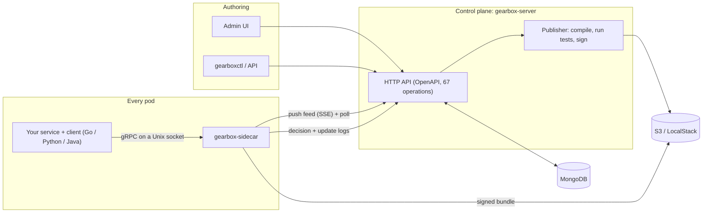
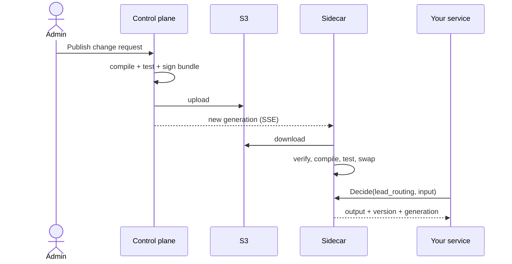

# Gearbox

Gearbox is a low-latency decision engine. Teams author **decisions** — rule sets, decision tables, JSON transforms and small decision graphs, with segments, lookups, feature gates, experiments and AI steps — against **registered, versioned schemas**, review and approve them, and publish them as **signed bundles**. A Go **sidecar** next to every service evaluates them in microseconds over gRPC on a Unix socket. Every answer carries the exact version and dependency hash that produced it, so any logged call can be replayed.


## How it works



1. **Author**: in the UI, register schemas, then build decisions (rules, tables, transforms, graphs) and segments, gates and experiments. A rules node cannot be saved without registered input and output schemas.
2. **Review**: cut a version, then open a change request. It shows the diff (including added and removed segment members) and runs every decision's tests. Approvals depend on the environment.
3. **Publish**: the control plane compiles everything into one bundle, runs the tests again, signs it (Ed25519) and uploads it to S3. The generation number goes up by one.
4. **Sync**: each sidecar is told about the new generation, downloads the bundle, checks the signature and hash, compiles it, runs its tests and swaps atomically. If anything fails, it keeps serving the previous version. It also keeps a copy on disk, so it starts even when the control plane is down.
5. **Decide**: your service calls the sidecar with a deadline and a fallback. Every answer carries the decision version, dependency hash and generation that produced it.



Step by step: [docs/06 · Setup and examples guide](docs/06-setup-and-examples-guide.md).

## Status (v1, 2026-10-31)

| Part | State | Verified |
|---|---|---|
| Engine | Schema registry rules, JSON Schema subset (nested, nullable), 35 operators, segment / gate / variant / Expr conditions, all node types, rollouts, dependency hash, tests, cost and PII checks, signed bundles | `go test -race`, fuzz, staticcheck; the old service's bucketing fixtures pass |
| Sidecar | Complete except OpenTelemetry export | unit tests + `make e2e` |
| Control plane + `gearboxctl` | All 67 API operations; memory / file / MongoDB stores; filesystem / S3 object stores; approvals, rollouts, rollback, kill switch, SSE feed; OIDC + local dev auth | every response checked against the OpenAPI file; MongoDB and S3 (LocalStack) suites |
| Admin UI (SvelteKit) | Every screen | `svelte-check` 0/0, 58 tests, build OK; all 29 screens opened against the real server with 0 browser errors; UI publish flow recorded ([GIF](docs/assets/ui-demo.gif)) |
| Go client | Complete | tests + `make e2e` |
| Python client | Thin wrapper | 5 tests against a real sidecar |
| Java client | Thin wrapper (Maven, Java 17) | 2 tests passed with Maven 3.9.9 + JDK 17 on Linux arm64 |
| Example services | Go, Python, Java (`POST /route`) + `gearbox-probe` | all three picked up a live change published in the control plane ([guide §3](docs/06-setup-and-examples-guide.md#3-make-a-change-and-watch-the-services-pick-it-up)) |
| **End to end** | `make e2e`: MongoDB 7 + LocalStack S3 → server (dev auth) → signed bundle in S3 → sidecar → Go service + probe. Covers decision version, segment members, gate, kill switch, experiment, rollout 50 % → 100 %, rollback, logs, control plane down, restart from disk, client fallback | **37/37 checks pass** (3 runs in a row) |
| AI decisions | Placeholder node and Hub contract only | excluded from this release |

## Measured performance

Measured on a **2-vCPU shared cloud sandbox** (client comparison: a 4-vCPU arm64 VM). In both, the load generator ran on the same CPUs as the sidecar. The full method, every run and the raw files are in **[docs/07 · Benchmarks](docs/07-benchmarks.md)**.

| What | Result |
|---|---|
| `lead_routing` graph, in-process engine | 9.6–10.1 µs |
| One 7-condition rule | 1.29–1.43 µs |
| Full call: Go client → Unix socket → sidecar, 1 caller | p50 212–254 µs, p99 577–753 µs (one 54.6 ms outlier in 15,000 calls) |
| Throughput, one sidecar | 233,201 calls/min at 1 caller · 716,432 at 8 · 945,521 at 32 (p99 6.2 ms), 0 errors |
| Sustained 60 s at 8 callers | 693,705 calls, p99 2.9 ms, 0 errors |
| Publish (build + test + sign + upload) | median 17.4 ms |
| Publish → sidecar serving the new version | median 4.4 ms with jitter off; 0.45–1.97 s with the default 2 s anti-thundering-herd jitter |
| Clients compared on a 4-vCPU arm64 VM | Go p50 76 µs, up to 3.12 M calls/min · Java p50 115 µs, up to 2.48 M/min · Python p50 136 µs, ~0.68 M/min (GIL-bound beyond 4 threads) |

## Before production

1. Fill in the Integration Hub contract in `contracts/openapi/integration-hub-ai.yaml` (placeholder).
2. Review `contracts/CHANGES-REQUESTED.md` (GBX-002).
3. Known gaps: OpenTelemetry export (GBX-123), AI cache and budget enforcement (GBX-122), OIDC sign-in not yet tested against a real identity provider (local runs use `GEARBOX_AUTH_MODE=dev`), and benchmarks on production hardware.

## Repository map

| Path | What | Owner branch |
|---|---|---|
| [`CONTRACTS.md`](CONTRACTS.md), [`contracts/`](contracts/), [`proto/`](proto/) | OpenAPI control-plane API and definition model, sidecar gRPC API, bundle format | lead (`main`) |
| [`engine/`](engine/) | Pure Go engine: validate, compile, evaluate; `engine/bundle` builds and opens signed bundles | `agent/dataplane` |
| [`sidecar/`](sidecar/) | `gearbox-sidecar`: gRPC server, sync, verify, swap, logs, metrics, Hub client | `agent/dataplane` |
| [`clients/go/`](clients/go/) | Go client (`gearbox.Dial`, `Decide`, …) | `agent/dataplane` |
| [`gen/go/`](gen/go/) | Generated Go code for the protos | `agent/dataplane` |
| [`controlplane/`](controlplane/) | `gearbox-server` (HTTP API, publisher, feed) and `gearboxctl` (CLI) | `agent/controlplane` |
| [`ui/`](ui/) | SvelteKit admin UI | `agent/ui` |
| [`clients/java/`](clients/java/), [`clients/python/`](clients/python/) | Thin wrappers (Maven / pip; stubs generated) | `agent/docs` |
| [`scripts/demo/`](scripts/demo/) | Live demo, change script, UI walkthrough recorder | `agent/docs` |
| [`examples/`](examples/) | `lead_service` definitions; the same service in [Go](examples/go-service/), [Python](examples/python-service/) and [Java](examples/java-service/); [`probe`](examples/probe/) test and load client | `agent/docs` |
| [`deploy/`](deploy/) | Dockerfiles, docker compose, Helm charts, local dev script | `agent/docs` |
| [`docs/`](docs/), [`tickets/`](tickets/) | Documentation and the ticket list | `agent/docs` |

## Quick start

Needs Go 1.24 (and Node 22 for the UI).

```bash
make dev                                   # server :8080 (seeded), sidecar, UI :5173
DEV_EXAMPLE=1 make dev                     # …plus the example service on :8081
curl -s -XPOST localhost:8081/route -d @examples/go-service/sample-lead.json
```

With Docker instead (adds MinIO, MongoDB and Redis):

```bash
cd deploy/compose && docker compose up --build
```

Sidecar only, from YAML files, no server:

```bash
make sidecar-offline                       # gearbox-sidecar --definitions-dir examples/definitions --allow-unsigned --watch
```

Live demo with Go, Python and Java services side by side: `make demo`, then change something in the UI at http://127.0.0.1:8080 or run `scripts/demo/change.sh block Indore`. See [the guide](docs/06-setup-and-examples-guide.md#2-run-everything-locally).

End to end against MongoDB and LocalStack S3 (needs Docker): `make e2e`. Benchmarks: `make bench-engine bench-sidecar bench-load bench-propagation`. Requirement-by-requirement proof: [docs/05-requirements-traceability.md](docs/05-requirements-traceability.md).

Other targets: `make build`, `make test`, `make vet`, `make ui`, `make gen`, `make check-names`, `make images` (`make help` lists all). In a network-restricted sandbox prefix them with `GEARBOX_RESTRICTED=1` (see [`scripts/dev/restricted-env.sh`](scripts/dev/restricted-env.sh)).

## Documentation

| Document | For |
|---|---|
| [docs/README.md](docs/README.md) | Overview and index |
| [docs/01-features.md](docs/01-features.md) | Every feature, how it works, with a case study each |
| [docs/02-user-stories.md](docs/02-user-stories.md) | Personas, user stories, acceptance criteria |
| [docs/03-implementation-guide.md](docs/03-implementation-guide.md) | Architecture, engine semantics, bundles, security, observability, standards, local dev, testing |
| [docs/04-reference.md](docs/04-reference.md) | Sidecar setup, all settings, gRPC API, operators, Expr, error codes, metrics |
| [docs/05-requirements-traceability.md](docs/05-requirements-traceability.md) | Each requirement, where it is built, how it is proven |
| [docs/06-setup-and-examples-guide.md](docs/06-setup-and-examples-guide.md) | Run everything locally, add the sidecar to a service (Go / Python / Java), UI walkthrough, MongoDB contents |
| [docs/07-benchmarks.md](docs/07-benchmarks.md) | Measured numbers, method and raw data |
| [tickets/TICKETS.md](tickets/TICKETS.md) | Work list for the whole system |

## Rules for contributors

- Edit only the paths your branch owns ([AGENTS.md](AGENTS.md)); request contract changes in `contracts/CHANGES-REQUESTED.md`.
- Conventional Commits; `gofmt`, `go vet`, `go test -race` green in your modules.
- No company names, internal hosts or company libraries: `make check-names` must pass.
