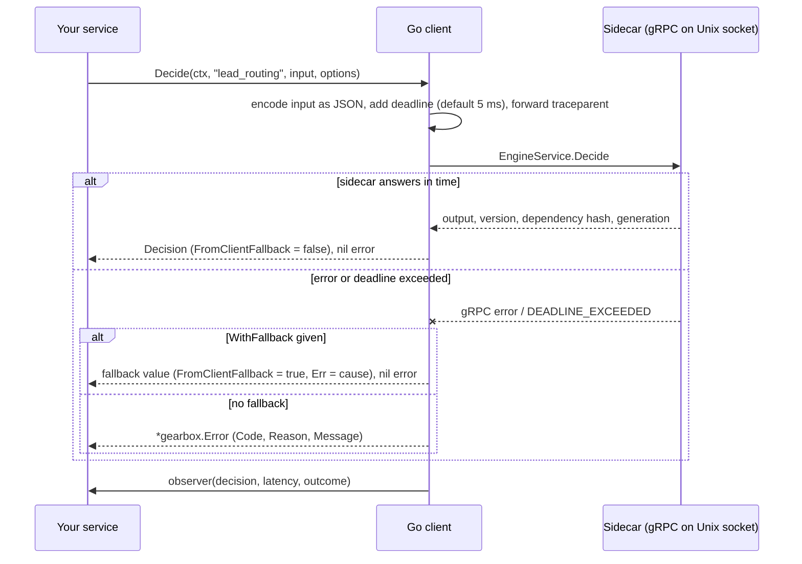

# clients/go — Go client for the Gearbox sidecar

Module `github.com/ORG/gearbox/clients/go`, package `gearbox`. A thin wrapper
over the generated `gearbox.v1` stubs that adds a deadline on every call, a
fallback value, request IDs, W3C `traceparent` propagation and a latency hook.
No Prometheus or OpenTelemetry dependency.

```go
client, err := gearbox.Dial(ctx, os.Getenv("GEARBOX_TARGET")) // "" → unix:///var/run/gearbox/engine.sock
if err != nil { return err }
defer client.Close()

d, err := client.Decide(ctx, "lead_routing", lead,
    gearbox.WithUnit(lead.ID),
    gearbox.WithTimeout(5*time.Millisecond),
    gearbox.WithFallback(map[string]any{"route": "manual_review"}))
// d.Output["route"], d.Version ("lead_routing@17"), d.FallbackUsed, d.FromClientFallback
log.Info("routed", "decision_version", d.Version, "dependency_hash", d.DependencyHash)
```

## How it works

The client holds one gRPC connection to the sidecar in the same pod. Each call
gets its own deadline; the client never retries (the sidecar is local, so a
retry only adds latency). With `WithFallback`, any failure — sidecar missing,
deadline exceeded, not ready, unknown decision, schema error — returns your
fallback value with a nil error, and the cause is kept in `Decision.Err`.



`Decision.FallbackUsed` is set when the sidecar itself used the decision's own
fallback (for example after a node error); `FromClientFallback` is set only
when the call failed and your `WithFallback` value was returned.

## Setup and run

The client needs a running sidecar. Point the sidecar at the control plane
with these environment variables (full list:
[docs/04-reference.md §2](../../docs/04-reference.md#2-sidecar-configuration)):

| Variable | Default | Meaning |
|---|---|---|
| `GEARBOX_SERVER_URL` | – (required) | Control-plane base URL |
| `GEARBOX_APP` / `GEARBOX_ENV` | – (required) | App and environment to serve |
| `GEARBOX_CREDENTIAL` or `GEARBOX_CREDENTIAL_FILE` | – (required) | App credential (`gbx_cred_…`) |
| `GEARBOX_TRUSTED_KEYS` or `GEARBOX_TRUSTED_KEYS_FILE` | – (required) | Public keys that bundles must be signed with |
| `GEARBOX_SOCKET` | `/var/run/gearbox/engine.sock` | Unix socket the client dials |
| `GEARBOX_CACHE_DIR` | `/var/cache/gearbox` | Last good bundle, used on restart |
| `GEARBOX_TCP_ADDR` + `GEARBOX_TCP_TOKEN_FILE` | off | Optional loopback TCP listener and its bearer token |

```bash
# from the repository root, against a control plane on :8080
GEARBOX_SERVER_URL=http://127.0.0.1:8080 GEARBOX_APP=lead_service GEARBOX_ENV=dev \
GEARBOX_CREDENTIAL=gbx_cred_… GEARBOX_TRUSTED_KEYS_FILE=trusted-keys.txt \
GEARBOX_SOCKET=/tmp/gearbox.sock GEARBOX_CACHE_DIR=/tmp/gearbox-cache \
  go run ./sidecar/cmd/gearbox-sidecar

# or without a control plane, straight from the example definitions
GEARBOX_SOCKET=/tmp/gearbox.sock \
  go run ./sidecar/cmd/gearbox-sidecar --definitions-dir examples/definitions --allow-unsigned --watch
```

Then, in your service:

```bash
# the module path github.com/ORG/... is a placeholder: inside this monorepo, go.work
# (or replace directives, as in examples/go-service/go.mod) resolves it
GEARBOX_TARGET=unix:///tmp/gearbox.sock go run .
```

Working programs: [examples/go-service](../../examples/go-service) (HTTP
service) and [examples/probe](../../examples/probe) (CLI, also the load
generator).

## API

- `Dial(ctx, target, ...DialOption)` — `unix:///path` (or `unix:/path`) or `host:port`
  (loopback TCP). Empty target → `unix:///var/run/gearbox/engine.sock`.
  Options: `WithToken` (TCP bearer token), `WithObserver(func(decision, d, outcome))`,
  `WithDefaultTimeout`, `WithWaitReady` (wait for `GetStatus.ready`), `WithGRPCOptions`.
- `Decide(ctx, decision, input, ...CallOption) (Decision, error)` — input is any
  JSON-encodable value, a JSON string, or `json.RawMessage`/`[]byte`. `Decision{Output, Raw,
  Version, DependencyHash, Generation, FallbackUsed, FromClientFallback, RequestID,
  EvalMicros, EvaluatedAt, Path, Err}`. `Output` is nil when the output is not a JSON
  object (use `Raw`).
- Call options: `WithUnit`, `WithTimeout` (default 5 ms), `WithFallback(v)` (any error →
  `v`, `FromClientFallback=true`, nil error, cause in `Decision.Err`), `WithRequestID`,
  `WithTrace` (per-node timings in `Path`), `WithForceLog`, `WithPinVersion`, `WithNow`.
- `DecideBatch(ctx, []BatchItem, ...CallOption)` (≤ 100 items, items fail independently;
  `WithFallback` is not applied per item),
  `CheckGate(ctx, gate, unit, attrs, ...)` (`WithFallback(bool)`),
  `GetVariant(ctx, experiment, unit, attrs, ...)` (`WithFallback("control")`),
  `Status(ctx)` (1 s deadline), `Close()`.
- Errors are `*gearbox.Error{Code, Reason, Message, Node, Fields}`; branch on
  `Reason` (`gearbox.IsReason(err, "DECISION_NOT_FOUND")`), never on `Message`.
- Trace context: `gearbox.WithTraceparent(ctx, tp)`, or incoming gRPC metadata
  `traceparent` is forwarded automatically.
- Observer outcomes: `ok`, `fallback` (sidecar used the decision fallback),
  `client_fallback`, `error`. Feed it into `gearbox_client_duration_seconds`.

## Decisions

- The client never retries against the local sidecar.
- Default timeout 5 ms; AI decisions need the node timeout plus a few ms.
- The latency hook is a plain function so the client stays dependency-light.

## Tests and benchmarks

```bash
cd clients/go
go test ./...                                   # in-process sidecar over a real Unix socket and loopback TCP
go test -run '^$' -bench DecideOverUnixSocket . # full-call benchmark
```

`gearbox_test.go` runs against an in-process sidecar (`sidecar/sidecartest`)
over a real Unix socket and over loopback TCP with a bearer token. Measured
latency and throughput are in [docs/07-benchmarks.md](../../docs/07-benchmarks.md).
