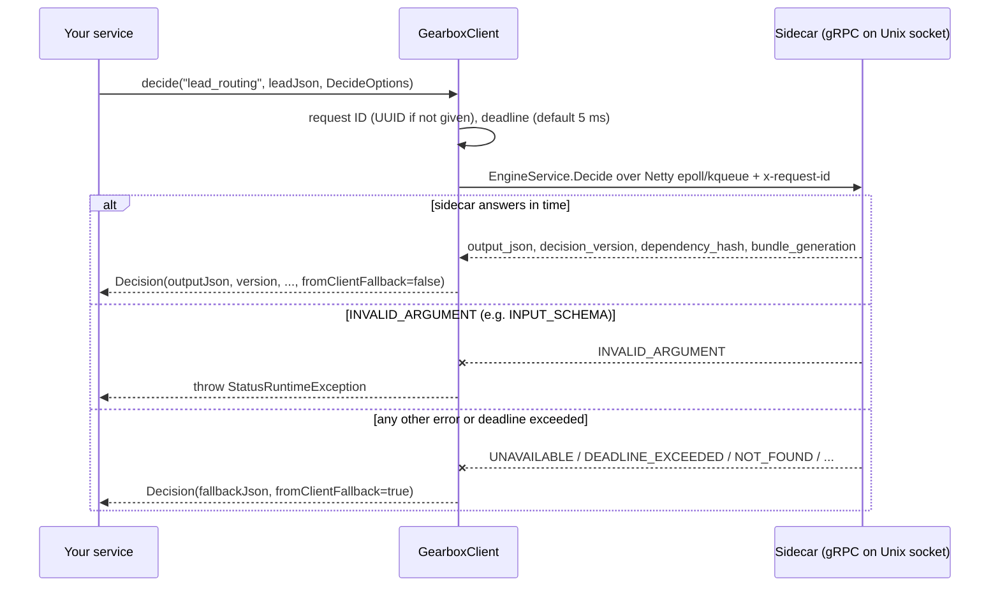

# Gearbox Java client (thin wrapper)

> **Stubs are generated at build time.** `protobuf-maven-plugin` runs protoc and
> `protoc-gen-grpc-java` on `../../proto/gearbox/v1/engine.proto` during `mvn package`.
> The build needs Maven Central access.

`org.gearbox.client.GearboxClient` adds to the generated stub: Unix-socket
transport (Netty native epoll on Linux, kqueue on macOS), a deadline per call
(default 5 ms), a fallback value when the sidecar cannot answer, and a request
ID (generated when not given, sent as `request_id` and as `x-request-id`
metadata).

Fallback rule: when a fallback is set, **every** gRPC error except
`INVALID_ARGUMENT` returns it (`UNAVAILABLE`, `DEADLINE_EXCEEDED`, `UNKNOWN`,
`NOT_READY`, `DECISION_NOT_FOUND`, `NODE_ERROR`, …). `INVALID_ARGUMENT` (for
example `INPUT_SCHEMA`) is thrown as `StatusRuntimeException`. Without a
fallback, every error is thrown.

## How it works



`connect(target)` picks the transport: `unix:///path` uses
`EpollDomainSocketChannel` when epoll is available (Linux x86_64 and aarch64),
otherwise `KQueueDomainSocketChannel` (macOS x86_64 and aarch64); any other
target is treated as `host:port` over plain TCP. The client never retries.

## Setup and run

Requirements: JDK 17+, Maven 3.9+.

```bash
cd clients/java
mvn -q package          # generates org.gearbox.v1.* into target/generated-sources, compiles, runs the tests
mvn -q install          # also puts gearbox-client-0.1.0-SNAPSHOT into ~/.m2 (needed by examples/java-service)
```

Without Maven, generate stubs by hand:

```bash
protoc -I ../../proto --java_out=src/main/java \
  --plugin=protoc-gen-grpc-java=/path/to/protoc-gen-grpc-java --grpc-java_out=src/main/java \
  ../../proto/gearbox/v1/engine.proto
```

### Tests

`GearboxClientTest` has 2 tests. `fallsBackWhenSidecarIsMissing` always runs.
`decidesAgainstRealSidecar` runs only when `GEARBOX_TEST_SIDECAR` points at a
sidecar serving `examples/definitions`:

```bash
# terminal 1, repository root
GEARBOX_SOCKET=/tmp/gbx.sock \
  go run ./sidecar/cmd/gearbox-sidecar --definitions-dir examples/definitions --allow-unsigned
# terminal 2
cd clients/java && GEARBOX_TEST_SIDECAR=unix:///tmp/gbx.sock mvn -q test
```

### The sidecar next to your service

The client dials `GEARBOX_TARGET` (pass it to `connect`; null or empty means
`unix:///var/run/gearbox/engine.sock`). The sidecar is configured with
`GEARBOX_SERVER_URL`, `GEARBOX_APP`, `GEARBOX_ENV`, `GEARBOX_CREDENTIAL` (or
`_FILE`), `GEARBOX_TRUSTED_KEYS_FILE` (or `GEARBOX_TRUSTED_KEYS`),
`GEARBOX_SOCKET` and `GEARBOX_CACHE_DIR`; see
[docs/04-reference.md §2](../../docs/04-reference.md#2-sidecar-configuration).

The sidecar's loopback TCP listener (`GEARBOX_TCP_ADDR`) always requires a
bearer token (`GEARBOX_TCP_TOKEN_FILE`), and this client has no option to send
one, so use the Unix socket.

## Use

```java
try (GearboxClient gearbox = GearboxClient.connect(System.getenv("GEARBOX_TARGET"))) {
  Decision d = gearbox.decide("lead_routing", leadJson,
      DecideOptions.unit(leadId)
          .timeout(Duration.ofMillis(5))
          .fallback("{\"route\":\"manual_review\"}"));
  log.info("route={} version={} hash={} clientFallback={}",
      d.outputJson(), d.version(), d.dependencyHash(), d.fromClientFallback());
}
```

- `DecideOptions.defaults()` / `DecideOptions.unit(id)`, then `.withUnit`, `.requestId`,
  `.timeout`, `.fallback(json)`; immutable, each call returns a copy.
- `Decision` is a record: `outputJson, version, dependencyHash, generation,
  fallbackUsed, fromClientFallback, requestId`.
- `checkGate(gate, unitId, attributesJson, fallback)` uses a fixed 5 ms deadline and
  returns `fallback` on any error except `INVALID_ARGUMENT`.

Create one `GearboxClient` per process (it is thread-safe and owns one event
loop thread). Never retry against the local sidecar; log `version` and
`dependencyHash` with your business event.

A complete service with a benchmark mode is in
[examples/java-service](../../examples/java-service). Measured numbers:
[docs/07-benchmarks.md](../../docs/07-benchmarks.md).
