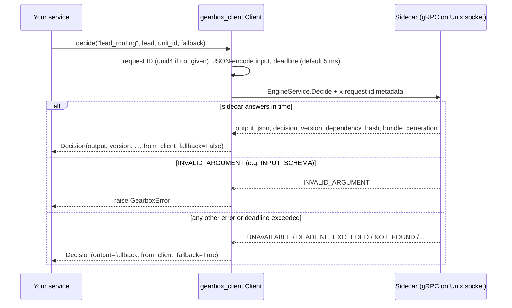

# Gearbox Python client (thin wrapper)

> **Needs stub generation.** The gRPC stubs are not committed. Generate them from
> `proto/gearbox/v1/engine.proto` with `scripts/gen.sh` (needs `grpcio-tools` from PyPI)
> before installing.

Adds to the generated stub: one channel per `Client`, a deadline on every call
(default 5 ms), a fallback value when the sidecar cannot answer, and a request
ID (generated when you do not pass one, sent as `request_id` and as
`x-request-id` metadata).

Fallback rule: when you pass `fallback=`, **every** gRPC error except
`INVALID_ARGUMENT` returns the fallback (`UNAVAILABLE`, `DEADLINE_EXCEEDED`,
`UNKNOWN` for an unusable socket path, `NOT_READY`, `DECISION_NOT_FOUND`,
`NODE_ERROR`, …). `INVALID_ARGUMENT` (for example `INPUT_SCHEMA`: the input
does not match the decision's schema) raises `GearboxError`, because a fallback
would hide a bug in the caller. Without `fallback=`, every error raises
`GearboxError`.

## How it works



The client never retries against the local sidecar.

## Setup and run

### Generate stubs and install

```bash
cd clients/python
python3 -m venv .venv && . .venv/bin/activate
pip install grpcio protobuf grpcio-tools
./scripts/gen.sh                 # writes gen/gearbox/v1/engine_pb2*.py
pip install -e '.[dev]'          # installs gearbox_client and the generated gearbox.v1 package
pytest                           # without a sidecar only the fallback test runs
```

`scripts/gen.sh` runs, from `clients/python`:

```bash
python -m grpc_tools.protoc -I ../../proto --python_out=gen --grpc_python_out=gen --pyi_out=gen \
  ../../proto/gearbox/v1/engine.proto
```

and adds the `__init__.py` files. Re-run it (and `pip install -e .` again)
whenever `engine.proto` changes.

### Run a sidecar next to your service

The client dials `GEARBOX_TARGET` (default `unix:///var/run/gearbox/engine.sock`).
The sidecar it talks to is configured with `GEARBOX_SERVER_URL`, `GEARBOX_APP`,
`GEARBOX_ENV`, `GEARBOX_CREDENTIAL` (or `_FILE`), `GEARBOX_TRUSTED_KEYS_FILE`
(or `GEARBOX_TRUSTED_KEYS`), `GEARBOX_SOCKET` and `GEARBOX_CACHE_DIR`; see
[docs/04-reference.md §2](../../docs/04-reference.md#2-sidecar-configuration).
For local work, run it from the example definitions (from the repository root):

```bash
GEARBOX_SOCKET=/tmp/gbx.sock \
  go run ./sidecar/cmd/gearbox-sidecar --definitions-dir examples/definitions --allow-unsigned
```

### Integration tests

`tests/test_sidecar_integration.py` (4 tests) runs against a real sidecar
serving `examples/definitions` and is skipped unless `GEARBOX_TEST_SIDECAR` is
set; `tests/test_fallback.py` (1 test) needs no sidecar.

```bash
GEARBOX_TEST_SIDECAR=unix:///tmp/gbx.sock pytest -v     # 5 tests
```

## Use

```python
from gearbox_client import Client, GearboxError

client = Client()  # GEARBOX_TARGET or unix:///var/run/gearbox/engine.sock; default_timeout=0.005
d = client.decide("lead_routing", lead, unit_id=lead["lead"]["id"],
                  timeout=0.005, fallback={"route": "manual_review"})
log.info("route=%s version=%s hash=%s fallback=%s",
         d.output["route"], d.version, d.dependency_hash, d.from_client_fallback)
```

- `Client(target=None, default_timeout=0.005)`; also a context manager (`with Client(...) as c:`).
- `decide(decision, input, *, unit_id="", request_id=None, timeout=None, fallback=None, trace=False)`
  → `Decision(output, version, dependency_hash, generation, fallback_used,
  from_client_fallback, request_id, path)`. `path` is a list of
  `(node_id, node_type, outcome)` (filled when `trace=True`).
- `check_gate(gate, unit_id="", attributes=None, *, timeout=None, fallback=None)` → `bool`;
  same fallback rule.
- `get_variant(experiment, unit_id, attributes=None, *, timeout=None)` returns the raw
  `GetVariantResponse`; it has no fallback and raises `grpc.RpcError` on failure.

Rules: reuse one `Client` per process; never retry against the local sidecar;
log `version` and `dependency_hash` with your business event.

A complete service and a benchmark script are in
[examples/python-service](../../examples/python-service). Measured numbers:
[docs/07-benchmarks.md](../../docs/07-benchmarks.md).
