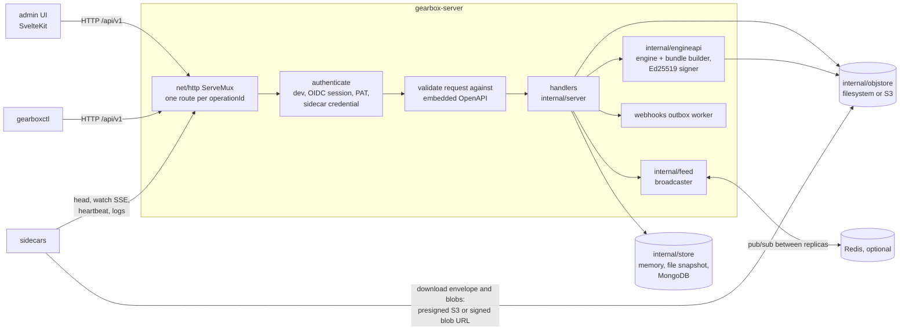
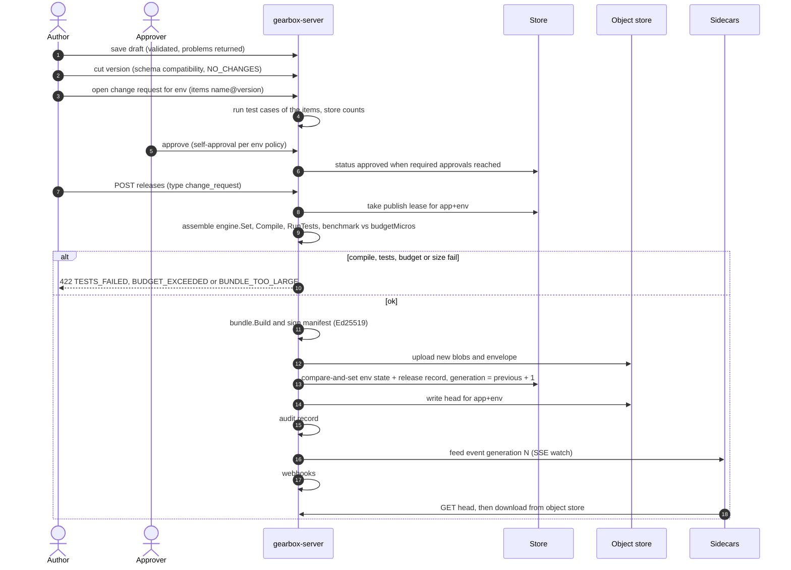

# Gearbox control plane

`gearbox-server` (the HTTP API in [`contracts/openapi/gearbox-admin.v1.yaml`](../contracts/openapi/gearbox-admin.v1.yaml), publishing, the sidecar feed) and `gearboxctl` (the CLI). Module `github.com/ORG/gearbox/controlplane`.

## How it works

### Components



### Release flow



Rollouts, rollbacks, data releases and kill switches go through the same
publish path with a different release type.

## Setup and run

The quickest full local stack is `make dev` (from the repository root): it
builds the binaries, generates a dev signing key in `.data/keys`, and runs
`gearbox-server --seed` on `:8080` (memory store, filesystem object store,
`GEARBOX_AUTH_MODE=dev`), a sidecar synced from it, and the UI dev server on
`:5173`. To run only the server:

```bash
source scripts/dev/restricted-env.sh   # only in the network-restricted sandbox
go build -o bin/ ./controlplane/cmd/...   # or: make build

# Everything in memory, seeded with the demo app, published to dev.
# Without GEARBOX_OIDC_ISSUER the server runs in dev auth mode; set it explicitly:
GEARBOX_AUTH_MODE=dev bin/gearbox-server serve --seed

# Or keep state between runs (JSON snapshot + filesystem object store):
export GEARBOX_STORE=file://$PWD/.data/store
bin/gearbox-server seed --demo     # prints a dev sidecar credential and the trusted key
bin/gearbox-server serve
```

Then:

```bash
curl -s localhost:8080/api/v1/apps/lead_service/decisions | jq .
curl -s -XPOST localhost:8080/api/v1/apps/lead_service/decisions/lead_routing/evaluate \
  -H 'content-type: application/json' \
  -d '{"input":{"lead":{"id":"L-1","city":"Gurgaon","source":"app"},"car":{"year":2019,"km":48200,"price":525000},"inspections":[{"part":"engine","score":8}]},"ctx":{"now":"2026-10-30T10:00:00Z","unit":"L-1029386"}}'
curl -s localhost:8080/api/v1/sidecar/v1/head -H "Authorization: Bearer $CREDENTIAL"   # signed blob URLs
curl -sN localhost:8080/api/v1/sidecar/v1/watch -H "Authorization: Bearer $CREDENTIAL" # SSE

export GEARBOX_SERVER_URL=http://localhost:8080 GEARBOX_APP=lead_service
bin/gearboxctl login                     # dev servers mint a token
bin/gearboxctl pull ./defs               # YAML files per kind
bin/gearboxctl push ./defs --cut -m "edit"
bin/gearboxctl change open --env prod --title "go live" decisions/lead_routing@1 schemas/lead_input@1 …
bin/gearboxctl release change-request cr_2 --env prod
bin/gearboxctl bundle export --env dev -o lead_service-dev.bundle   # for gearbox-sidecar --bundle-file
```

In dev auth mode every request is `GEARBOX_DEV_USER` (`dev@localhost`, role `GEARBOX_DEV_ROLE`=`admin`); send `X-Gearbox-Dev-User` / `X-Gearbox-Dev-Role` to act as someone else. Never use dev mode outside local development.

Tests: `cd controlplane && go vet ./... && go test -race ./...` (or `make vet test` for every module). Redis tests start a local `redis-server` when installed (or use `GEARBOX_TEST_REDIS_URL`); MongoDB and S3 integration tests run when `GEARBOX_TEST_MONGO_URI` / `GEARBOX_TEST_S3_URL` are set. `make e2e` runs MongoDB + LocalStack S3 in Docker, then server → S3 bundle → sidecar → example service.

Publish time and publish-to-sidecar propagation are measured by `make bench-propagation`; see [Benchmarks](../docs/07-benchmarks.md) for measured numbers.

## Configuration

Names follow [docs/04-reference.md](../docs/04-reference.md) §3; names in parentheses are accepted aliases.

| Variable | Default | Meaning |
|---|---|---|
| `GEARBOX_HTTP_ADDR` (`GEARBOX_ADDR`) | `:8080` | API (`/api/v1`), UI, `/healthz`, `/readyz` |
| `GEARBOX_METRICS_ADDR` | `:9464` | `/metrics`, `/readyz`, `/livez` (`off` disables) |
| `GEARBOX_PUBLIC_URL` | `http://localhost<addr>` | External URL: OIDC redirect, filesystem blob URLs |
| `GEARBOX_STORE` | `memory` | `memory`, `file:///dir` (memory + JSON snapshot), `mongo` (with `GEARBOX_MONGO_URI`/`GEARBOX_MONGO_DB`), or a `mongodb://…` URI |
| `GEARBOX_OBJECT_STORE` | `file://./.data/objects` | `file:///dir` or `s3://bucket/prefix?region=…&endpoint=…&pathStyle=true&presignEndpoint=…` |
| `GEARBOX_S3_ENDPOINT`, `GEARBOX_S3_REGION`, `GEARBOX_S3_FORCE_PATH_STYLE`, `GEARBOX_S3_PRESIGN_ENDPOINT` | – | Override the `s3://` query parameters. Credentials: `AWS_*`, `MINIO_*`, `~/.aws/credentials`, IAM |
| `GEARBOX_PRESIGN_TTL` | `15m` | Lifetime of download URLs |
| `GEARBOX_SIGNING_KEY_FILE` (`GEARBOX_SIGNING_KEY`) | dev: generated in `GEARBOX_DATA_DIR/signing.key` | Ed25519 key: file (base64 seed/key or PEM PKCS#8) or inline base64 seed. Required outside dev mode |
| `GEARBOX_SIGNING_KEY_ID` | `dev` | `key_id` in envelopes |
| `GEARBOX_HMAC_KEY_FILE` (`GEARBOX_SECRET`) | derived from the signing key | Installation HMAC key: hashes stored tokens/credentials, signs blob URLs, HMACs `pii` segment members (shared with sidecars) |
| `GEARBOX_AUTH_MODE` (`GEARBOX_AUTH`) | `oidc` when `GEARBOX_OIDC_ISSUER` is set, else `dev` | `dev`: every request is `GEARBOX_DEV_USER` (`dev@localhost`) with `GEARBOX_DEV_ROLE` (`admin`); header `X-Gearbox-Dev-User` (and `X-Gearbox-Dev-Role`) selects another user |
| `GEARBOX_OIDC_ISSUER`, `GEARBOX_OIDC_CLIENT_ID`, `GEARBOX_OIDC_CLIENT_SECRET_FILE` | – | OIDC provider (redirect URI: `<public url>/api/v1/auth/callback`) |
| `GEARBOX_ADMIN_EMAILS` | – | Bootstrap admins created on first OIDC sign-in |
| `GEARBOX_SESSION_KEY_FILE` | derived | Signs the OIDC state cookie (sessions are stored server-side) |
| `GEARBOX_SESSION_TTL` | `12h` | Browser session lifetime |
| `GEARBOX_REDIS_URL` | – | Feed fan-out between replicas (needed with more than one replica) |
| `GEARBOX_UI_DIR` / `GEARBOX_UI_ORIGIN` | – | Serve the built UI (SPA fallback to `index.html`) / allow CORS from the UI dev server |
| `GEARBOX_LOG_RETENTION` | `336h` | TTL of sidecar-uploaded logs (`14d` also accepted) |
| `GEARBOX_LOG_LEVEL` / `GEARBOX_LOG_FORMAT` | `info` / `json` | slog level / `text` for humans |
| `GEARBOX_ENGINE` | `auto` | `auto` (real engine, lite fallback per unimplemented function), `real`, `lite` |
| `GEARBOX_PUBLISH_BENCHMARK` / `GEARBOX_BUDGET_FACTOR` | `true` / `1` | Benchmark at publish; fail when p99 > `budgetMicros` × factor |
| `GEARBOX_SEED` / `serve --seed`, `GEARBOX_SEED_DIR`, `GEARBOX_SEED_CREDENTIAL` | `false`, `examples/definitions`, – | Seed at start: import the definitions directory (built-in demo when it does not exist), publish to dev, optionally register a known credential secret |
| `GEARBOX_DATA_DIR` | `./.data` | Dev key files |

`gearbox-server keygen --out DIR --id ID [--if-missing]` and `gearboxctl keys generate …` write `signing.key` and `trusted-keys.txt` (`ID:base64`).

## Architecture

```
cmd/gearbox-server   serve | seed | keygen          cmd/gearboxctl   CLI over internal/client
internal/server      routes (one per contract operation) → authenticate → validate request against
                     the embedded OpenAPI → handler. Publishing, change requests, sidecar feed, runtime,
                     webhooks outbox worker, metrics.
internal/apispec     embedded copy of the contract (drift test keeps it identical)
internal/engineapi   seam over engine/ and engine/bundle: real | lite | auto, dependency extraction,
                     lite engine (JSON Schema subset, compatibility, field conditions, murmur3 bucketing),
                     lite bundle writer (bundle.proto wire format via protowire, zstd, Ed25519)
internal/store       Backend (CAS documents, TTL records, leases) → typed Store. memory (+snapshot),
                     store/mongostore (driver v2). storetest = conformance suite for both.
internal/objstore    fs (signed /sidecar/v1/blobs URLs) and S3 (minio-go presigned URLs)
internal/feed        in-process broadcaster + Redis pub/sub relay
internal/auth        token/credential hashing, Ed25519 keys, OIDC client
internal/model       API and storage types (hand-written from the contract)
internal/seed, defs, client   demo seeder, definition files (docs §10), API client
```

**Publish pipeline** (`POST …/releases`): per app+env lease → compute the new live state (change request items, data items, rollout step, rollback to a recorded state, kill switch) → assemble the full `engine.Set` (live versions, rollout "from" versions, every pinned schema version, killed gates) → `engine.Compile` → `RunTests` (422 `TESTS_FAILED`) → benchmark vs `budgetMicros` (422 `BUDGET_EXCEEDED`) → `bundle.Build` → size check (422 `BUNDLE_TOO_LARGE`) → upload new blobs to `blobs/sha256/<hex>`, the envelope to `envelopes/<app>/<env>/<gen>.pb` (and a copy at `blobs/sha256/<envelope sha>`) → compare-and-set commit of the environment state + release record (generation = previous + 1) → `heads/<app>/<env>.json` → audit, feed event, webhooks.

**Sidecar endpoints**: `head` (ETag `"g<gen>-<hash of have>"`, 304, `have` filter, URLs from the object store), `watch` (SSE: current generation on connect, `generation` events, `ping` every 15 s), `blobs/{sha256}` (filesystem store; `sig`/`exp` HMAC), `heartbeat` (fleet + 25 h of samples for the overview latency series), `logs` (decision/update/exposure records with TTL; the memory store keeps a bounded ring of 200k per collection).

## Decisions

- **net/http ServeMux + hand-written types**, not oapi-codegen (could not build it here). The contract is still enforced: every route is bound to an `operationId` (startup fails if any operation lacks a handler), requests are validated against the embedded YAML with kin-openapi, and the test suite validates every response against the YAML (`TestMain` fails unless all 67 operations were exercised; 124 operation/status pairs are covered).
- **Request validation errors**: body errors are `422 VALIDATION_FAILED` when the operation declares 422, else `400 INVALID_ARGUMENT`; parameter errors are 400. Resource specs (`createResource`, `saveDraft`, `validateResource`) are validated by the handler against the kind's component schema *after* the schema-registry rule, so a rules node without schemas yields `SCHEMA_REQUIRED`, not a generic shape error, and `validate` always answers 200.
- **Status codes** per the lead: `NOT_APPROVED` 409, `TESTS_FAILED` 422, `BUNDLE_TOO_LARGE` 422. Additional codes: `BREAKING_CHANGE` 422 (schema cut), `NO_CHANGES` 409 (cut of an unchanged draft), `INVALID_STATE` 409 (change request transition), `NOT_ROLLING_OUT` 409, `BUDGET_EXCEEDED` 422, `BUSY` 409 (publish lease timeout), `NODE_ERROR` 500 (remote decide without fallback), field code `DEPENDENCY_NOT_LIVE`.
- **One Store over a tiny Backend**: CAS, revision conflicts, counters and strictly increasing generations are implemented once (`CommitRelease` compares the environment document version and generation) and checked by a conformance suite run on both backends, including 8 concurrent publishers. Publishing also takes a lease (`Backend.Lock`, Mongo lease document across replicas).
- **Large data** (segment members, lookup rows) is stored content-addressed at `data/sha256/<hex>` in the object store; drafts and versions keep `{sha256, count}`.
- **Engine seam with fallback**: `GEARBOX_ENGINE=auto` uses the data-plane engine and only falls back to the lite engine for functions that still return `ErrNotImplemented`, so the control plane worked before the engine existed and now runs fully on it. The lite engine never evaluates Expr; its decisions return the fallback, and its test runs only judge input-schema cases (clearly marked "not evaluated").
- **Schemas in bundles**: the set contains every schema version pinned by any included resource (several versions of one schema may coexist); only decisions/segments/etc. need to be live by name.
- **Rollouts**: a change item with `rollout.percent < 100` keeps the previous live version as `fromVersion`; `rollout` releases set the percent, 100 completes, 0 keeps the rollout at 0 % (so it can resume). Salt: `<decision>.rollout.<version>`.
- **Rollback** restores the full recorded state (live versions + killed gates) of the target generation as a new generation; `breakGlass` when no `changeRequestId` is given.
- **Roles**: viewer reads; author drafts, cuts versions, opens change requests, publishes approved change requests and data releases; approver approves/rejects, rollouts, rollbacks, kill switches; admin manages apps, environments, credentials, members, webhooks. Member `apps` scope hides other apps (404) and filters the audit trail. Withdraw is author-only.
- **Secrets** (PATs, credentials, session ids) are stored as HMAC-SHA256 under the installation key. Credential secrets look like `gbx_cred_<env>_<id>_<random>`.
- **Blob URLs are self-authenticating** (HMAC `sig` + `exp`); a credential is checked only if sent. Presigned S3 URLs must not receive an `Authorization` header.
- **PII segments**: members are stored and shipped as hex HMAC-SHA256 under the installation HMAC key; the check endpoint hashes the key the same way.
- **Remote decide** logs decision records at the environment's `logSampleRate` (or `forceLog`) without input/output payloads, and every exposure.
- **Demo decision** follows the OpenAPI example plus the data-plane fixture (`inputSchema`, `logging`, six test cases including the unit inside r4's 25 % rollout).

## Gaps and known limitations

- **OIDC** is implemented (go-oidc, state/nonce cookie, server-side sessions, CSRF) but only the session/CSRF half is tested; no identity provider was reachable here.
- **MongoDB**: the backend compiles and its helpers are unit-tested; the conformance suite (`GEARBOX_TEST_MONGO_URI`) has never run in this sandbox (no MongoDB binary). Same for the S3 store (`GEARBOX_TEST_S3_URL`); presigning is tested offline.
- `controlplane/go.sum` is committed; in the restricted sandbox vanity module paths resolve through GitHub mirrors (`scripts/dev/restricted-env.sh`). If it drifts, run `go mod tidy` in `controlplane/` on a machine with normal module proxy access.
- kin-openapi v0.128 (the last line that builds with Go 1.24) ignores OpenAPI 3.1 `const`, so response validation does not check `type: decision|update|exposure` on log records.
- `ResourceSummary.stats` come from sampled decision logs of the last hour in `prod` (calls/minute is the sampled count).
- The shadow report reads `ai[].result` as the AI's label (or `timeout`/`schema_error`/`error`) and an extra `ai[].decided` field (falls back to the record's `output`); see the change request.
- Webhook secrets are stored in clear (needed to sign); no per-endpoint rate limiting; audit and log search in the memory store scan in-process.
- The lite bundler's offline file format (`GBXB1`) is only used if `bundle.WriteFile` is unimplemented; with the data-plane package present the real format is written.

## For the UI and data-plane teams

- Dev mode needs no login; `X-Gearbox-Dev-User: email` (+ optional `X-Gearbox-Dev-Role`) impersonates. CORS: set `GEARBOX_UI_ORIGIN=http://localhost:5173`. `GET /session` returns `csrfToken`; send it as `X-CSRF-Token` on mutating requests when using the cookie.
- Draft responses include `draft.validation` (engine problems) even when the save succeeded; `POST …/validate` never fails for bad specs.
- `segments` drafts show `spec.static.memberCount`, `lookups` show `spec.rowCount` (read-only; stripped on save).
- Sidecars: `GET /api/v1/sidecar/v1/head` → envelope URL is a blob URL of the envelope's sha256; resource list is the manifest's blob hashes minus `have`. Do not send `Authorization` to blob URLs. The watch stream sends the current generation immediately on connect.
- Heartbeat `p99Micros`/`callsPerMinute`/`fallbackRate` drive the overview. Update records with `result: kept_previous` (or an `error`) fire the `sidecar.sync_failed` webhook.
