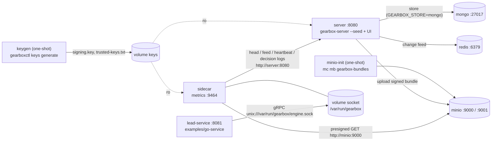

# Gearbox with docker compose

Runs the whole system locally: control plane, S3 (MinIO), MongoDB, Redis, one sidecar and the example lead service.

| Service | What | Port |
|---|---|---|
| `keygen` | One-shot: `gearboxctl keys generate` writes the dev signing key and `trusted-keys.txt` into the `keys` volume (skipped if present) | – |
| `minio` + `minio-init` | S3-compatible object store; creates bucket `gearbox-bundles` | 9000 (API), 9001 (console, `gearbox` / `gearbox-dev-secret`) |
| `mongo` | MongoDB, used when `GEARBOX_STORE=mongo` | 27017 |
| `redis` | Change-feed fan-out (`GEARBOX_REDIS_URL`) | 6379 |
| `server` | `gearbox-server --seed` with the UI; dev auth (no OIDC) | 8080 (API + UI), 9465 on the host → 9464 in the container (metrics) |
| `sidecar` | `gearbox-sidecar` for `lead_service` / `dev`, synced from the server, bytes from MinIO | 9464 (metrics, `/readyz`) |
| `lead-service` | `examples/go-service` calling the sidecar over the shared Unix socket | 8081 |

## How it works



Start order is enforced with `depends_on`: `keygen` and `minio-init` must
finish, `mongo` and `redis` must be healthy before `server` starts; `sidecar`
starts after `server`; `lead-service` waits until `sidecar` is healthy
(`gearbox-sidecar healthcheck`, which calls `/readyz`).

## Setup and run

### Start

```bash
cd deploy/compose
docker compose up --build                       # memory store (data is lost on restart)
GEARBOX_STORE=mongo docker compose up --build   # keep data in MongoDB
# or from the repository root: make compose-up
```

What happens:

1. `keygen` creates `/keys/signing.key` and `/keys/trusted-keys.txt` (`dev-local:<base64 public key>`).
2. `minio-init` creates the bucket.
3. `server --seed` creates app `lead_service`, imports `examples/definitions` (schemas, segments, `lead_routing`), cuts version 1 of each, publishes generation 1 to `dev` (signed with the dev key, uploaded to MinIO) and registers `GEARBOX_DEV_CREDENTIAL` as the `dev` credential.
4. `sidecar` fetches the head from the server, downloads the bundle from MinIO, verifies it with `trusted-keys.txt`, compiles it, runs its tests and becomes healthy.
5. `lead-service` starts once the sidecar is healthy.

### Try it

```bash
curl -s -XPOST localhost:8081/route -d @../../examples/go-service/sample-lead.json
# {"route":"standard","reason":"default","version":"lead_routing@1","dependencyHash":"sha256:…","generation":1,...}

curl -s localhost:9464/readyz                    # sidecar readiness
open http://localhost:8080                        # admin UI (signed in as the dev user, no OIDC)
curl -s localhost:8080/api/v1/apps/lead_service/environments/dev/sidecars   # fleet (dev auth)
```

Change a rule in the UI, cut a version, open a change request for `dev` and publish it: the sidecar logs an update record and the next `curl` shows the new `version` and `generation`.

## The dev signing key's trusted-keys line

Sidecars (and any other environment you point at this server) need the public key. It is printed by `keygen` and stored in the `keys` volume:

```bash
docker compose logs keygen                              # prints: trusted key: dev-local:MCowBQYDK2VwAyEA…
docker run --rm -v gearbox_keys:/keys busybox cat /keys/trusted-keys.txt
```

Use the line as `GEARBOX_TRUSTED_KEYS=dev-local:…` or put the file in a ConfigMap (`keys.txt`) for Kubernetes. To rotate, delete the volume (`docker compose down -v`) — every sidecar must then get the new line.

## Settings you may change

| Variable (shell or `.env`) | Default | Effect |
|---|---|---|
| `GEARBOX_STORE` | `memory` | `mongo` keeps definitions across restarts |
| `GEARBOX_DEV_CREDENTIAL` | `gbx_cred_dev_local_0000000000000000` | Shared by `server` (seeded) and `sidecar` |
| `MINIO_ROOT_USER` / `MINIO_ROOT_PASSWORD` | `gearbox` / `gearbox-dev-secret` | MinIO and S3 credentials |

All other settings are in [docs/04-reference.md](../../docs/04-reference.md) §2–§3.

## Notes

- The sidecar and the example service share the `socket` volume. Both run as uid 65532, so the `0660` socket is reachable without `fsGroup`.
- Presigned URLs use `http://minio:9000`, which resolves inside the compose network. To fetch bundles from the host, set `GEARBOX_S3_PRESIGN_ENDPOINT=http://localhost:9000` (then in-network sidecars cannot use them).
- Network-restricted sandbox: build images with `docker compose build --build-arg GEARBOX_RESTRICTED=1` (uses `scripts/dev/restricted-env.sh`).
- Stop and remove everything: `docker compose down -v`.
