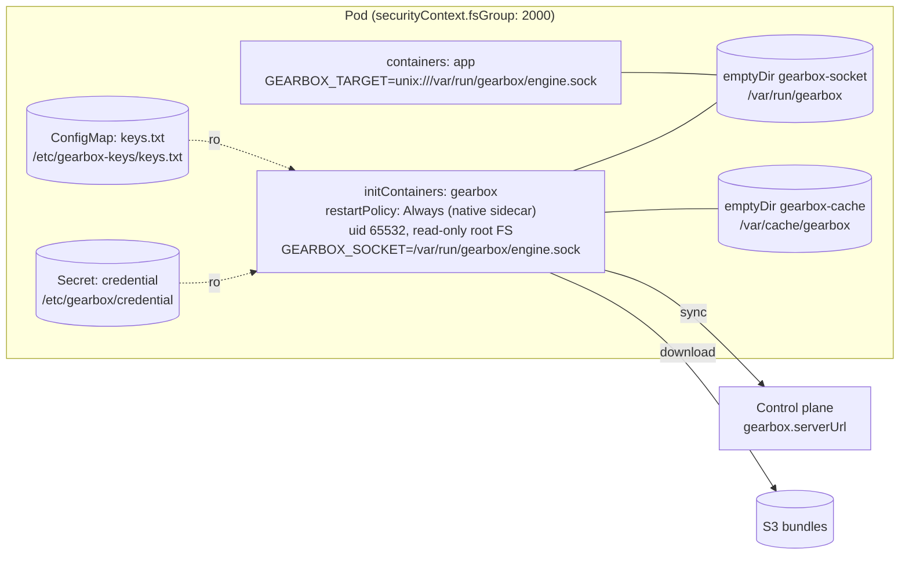

# gearbox-sidecar (Helm library chart)

Renders the Gearbox sidecar into **your** service's pod: a Kubernetes native sidecar (init container with `restartPolicy: Always`, Kubernetes 1.29+), the socket and cache `emptyDir`s, volumes that mount your credential Secret and trusted-keys ConfigMap (the chart does not create them), `fsGroup`, `GOMAXPROCS` from the CPU request, startup/readiness probes on `/readyz` and a liveness probe on `/livez` (port 9464), and no CPU limit.

## How it works



With `nativeSidecar: true`, Kubernetes starts the `gearbox` init container
first and starts `app` only after its startup probe (`/readyz`, i.e. a bundle
is loaded) succeeds; the sidecar keeps running for the pod's lifetime and is
stopped after the app on shutdown. The socket is created with mode `0660`;
`fsGroup` gives both containers the group that owns the `emptyDir`, so the app
can connect without running as the sidecar's user.

## Setup and run

### Use it from a service chart

```yaml
# Chart.yaml
dependencies:
  - name: gearbox-sidecar
    version: 0.1.0
    repository: "file://../path/to/deploy/helm/gearbox-sidecar"
```

```yaml
# values.yaml
gearbox:
  app: lead_service
  env: prod
  serverUrl: https://gearbox.example.com
  credentialSecret: lead-service-gearbox-prod     # key "credential"
  trustedKeysConfigMap: gearbox-trusted-keys      # key "keys.txt"
  resources:
    requests: { cpu: 500m, memory: 128Mi }
    limits: { memory: 512Mi }
```

```yaml
# templates/deployment.yaml
apiVersion: apps/v1
kind: Deployment
metadata: { name: lead-service }
spec:
  selector: { matchLabels: { app: lead-service } }
  template:
    metadata: { labels: { app: lead-service } }
    spec:
      securityContext:
        {{- include "gearbox-sidecar.podSecurityContext" .Values.gearbox | nindent 8 }}
      initContainers:
        {{- include "gearbox-sidecar.container" .Values.gearbox | nindent 8 }}
      containers:
        - name: app
          image: lead-service:2.3.1
          env:
            {{- include "gearbox-sidecar.appEnv" .Values.gearbox | nindent 12 }}
          volumeMounts:
            {{- include "gearbox-sidecar.appVolumeMounts" .Values.gearbox | nindent 12 }}
      volumes:
        {{- include "gearbox-sidecar.volumes" .Values.gearbox | nindent 8 }}
```

Kubernetes older than 1.29: set `gearbox.nativeSidecar: false` and include `gearbox-sidecar.container` under `containers:` instead; make the app wait for `GetStatus.ready` (Go client: `gearbox.Dial(ctx, target, gearbox.WithWaitReady())`).

Environment the helper sets on the sidecar: `GEARBOX_APP`, `GEARBOX_ENV`, `GEARBOX_SERVER_URL` (when `serverUrl` is set), `GEARBOX_CREDENTIAL_FILE=/etc/gearbox/credential` (when `credentialSecret` is set), `GEARBOX_TRUSTED_KEYS_FILE=/etc/gearbox-keys/keys.txt`, `GEARBOX_SOCKET`, `GEARBOX_CACHE_DIR`, `GEARBOX_METRICS_ADDR`, `GEARBOX_LOG_SINK`, `GEARBOX_SIDECAR_ID` (pod name), `GEARBOX_NODE_NAME`, `GOMAXPROCS`, plus `extraEnv`.

### Create the credential Secret and trusted keys

Once per namespace:

```bash
kubectl create secret generic lead-service-gearbox-prod --from-literal=credential=gbx_cred_prod_…
kubectl create configmap gearbox-trusted-keys --from-file=keys.txt=trusted-keys.txt
```

Render to check the result: `helm dependency update && helm template .` in your service chart.

All settings: [values.yaml](values.yaml); environment variables: [docs/04-reference.md §2](../../../docs/04-reference.md#2-sidecar-configuration).
