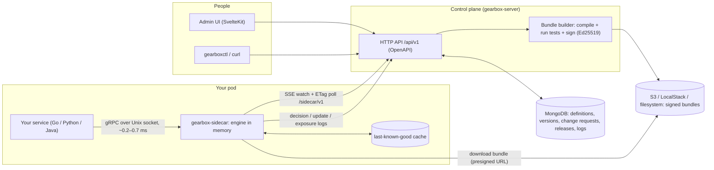
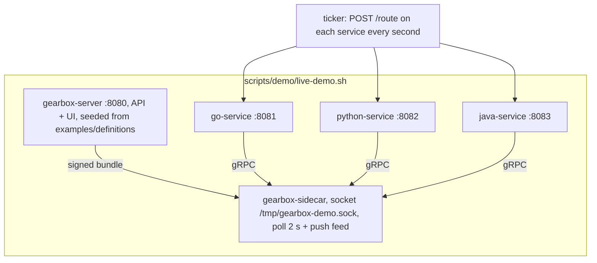
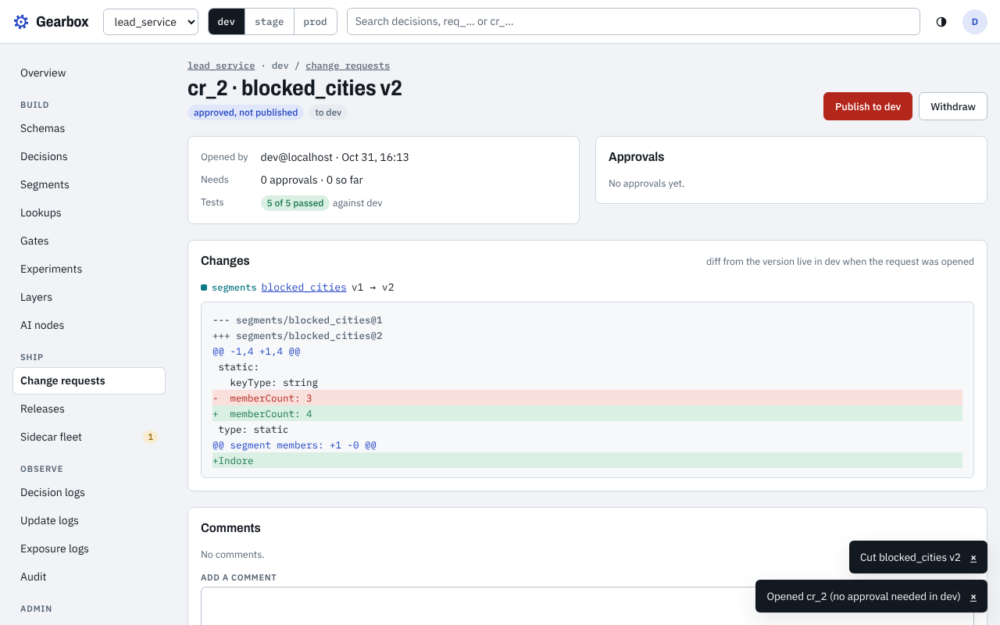
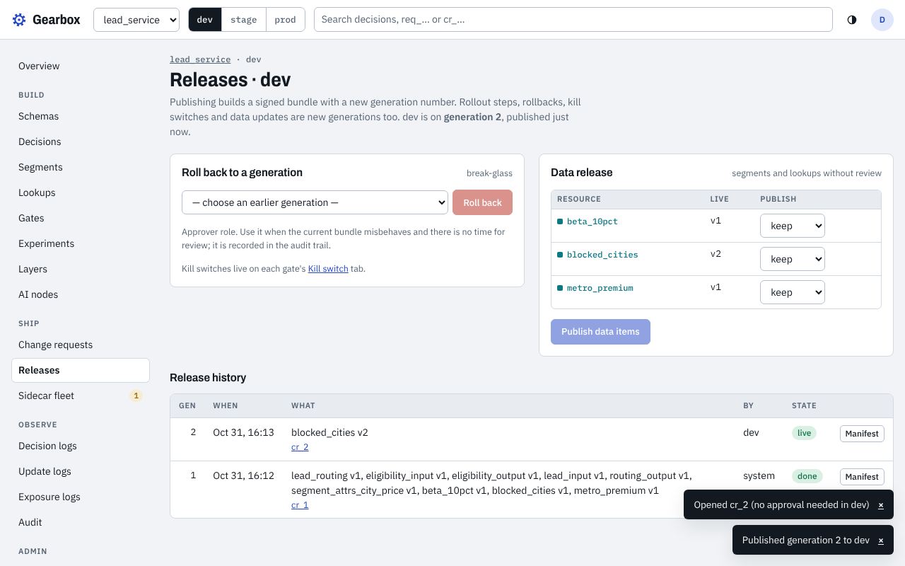
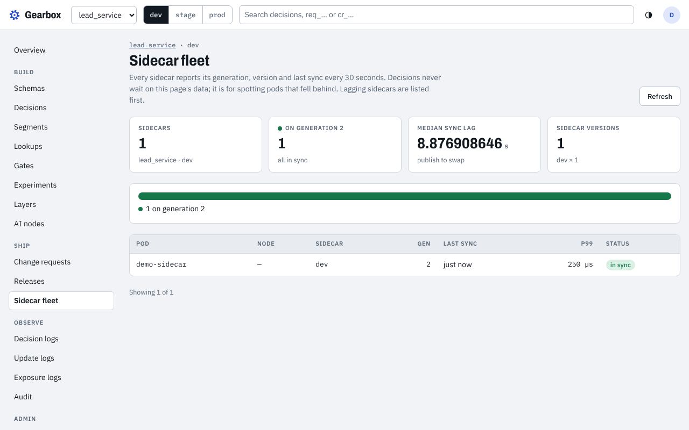
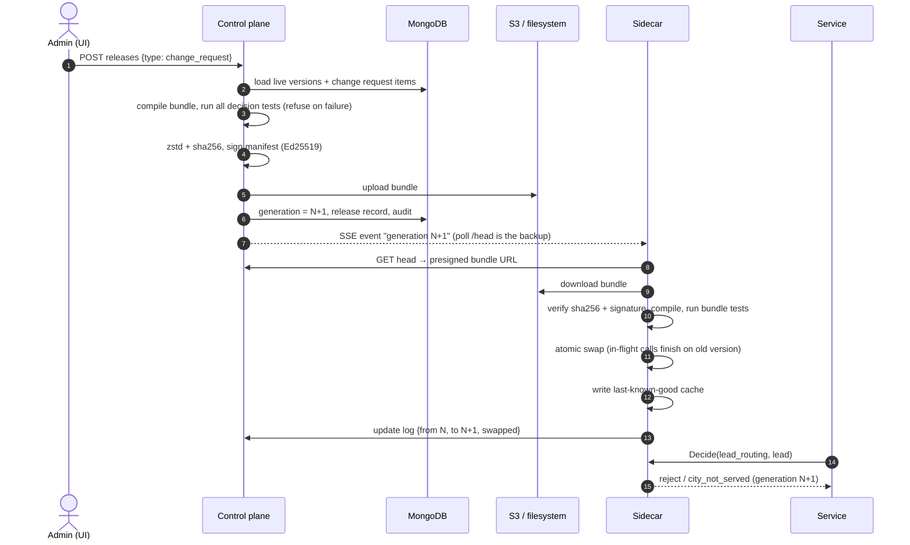
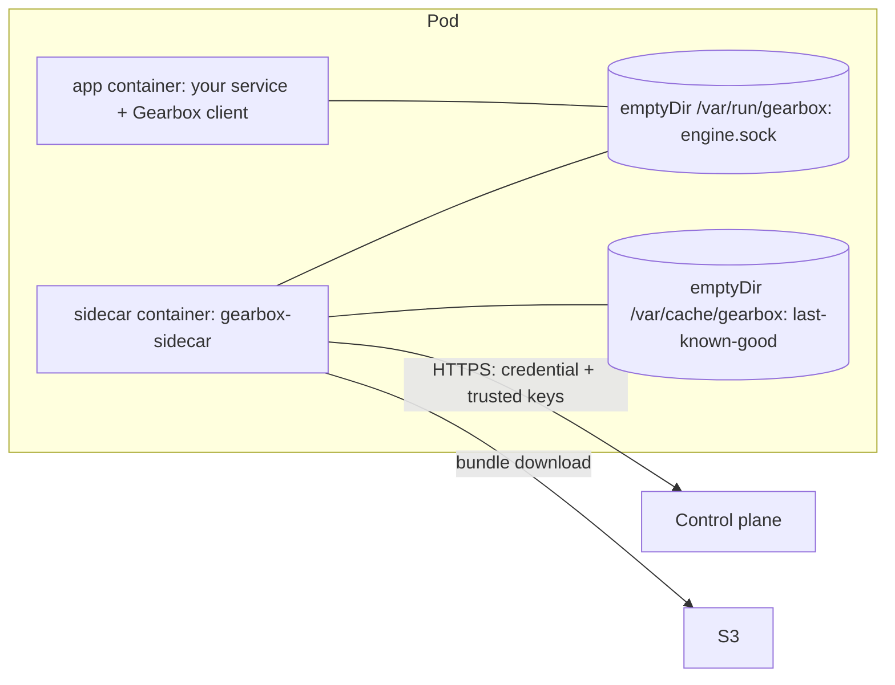
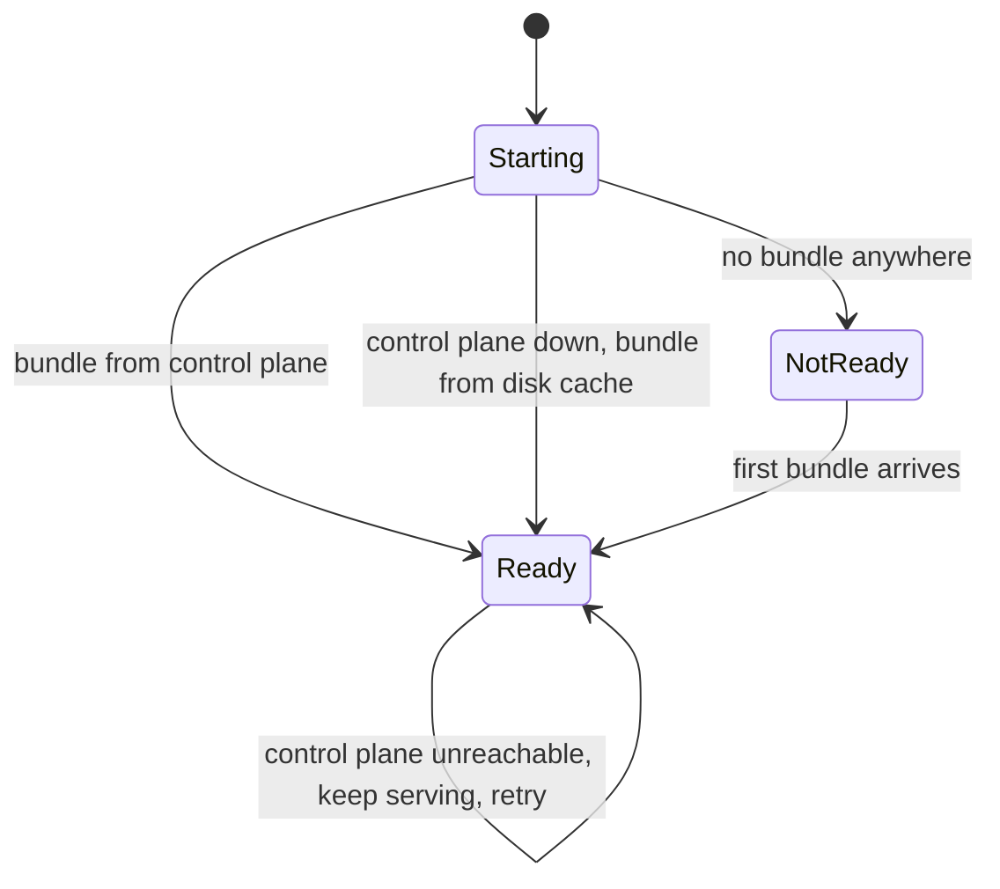
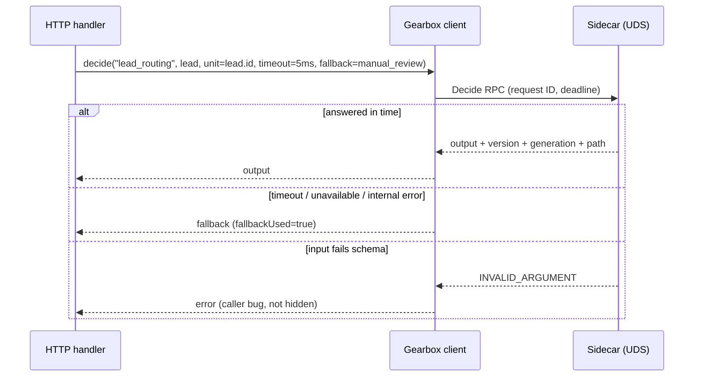

# 06 · Setup and examples guide

This guide covers how to run the whole system on one machine, how a service adds the sidecar (Go, Python, Java), and what happens when someone changes a rule in the UI. Every command here has been run. The measured numbers are in [07 · Benchmarks](07-benchmarks.md).

- [1. The moving parts](#1-the-moving-parts)
- [2. Run everything locally](#2-run-everything-locally)
- [3. Make a change and watch the services pick it up](#3-make-a-change-and-watch-the-services-pick-it-up)
- [4. Add the sidecar to your service](#4-add-the-sidecar-to-your-service)
- [5. Calling the sidecar from Go, Python and Java](#5-calling-the-sidecar-from-go-python-and-java)
- [6. Running in Kubernetes and Docker Compose](#6-running-in-kubernetes-and-docker-compose)
- [7. Where the data lives in MongoDB and S3](#7-where-the-data-lives-in-mongodb-and-s3)
- [8. Tests that prove it works](#8-tests-that-prove-it-works)
- [9. Troubleshooting](#9-troubleshooting)

## 1. The moving parts



| Part | What it does | Code |
|---|---|---|
| Control plane | Stores definitions (schemas, decisions, segments, gates, experiments) with versions; change requests, approvals, releases, rollouts, rollback, kill switch. On publish it builds a bundle, runs every decision's tests, signs it and uploads it. | [`controlplane/`](../controlplane/README.md) |
| Admin UI | Every screen for the API above. Served by the control plane from `ui/build`. | [`ui/`](../ui/README.md) |
| Sidecar | One per pod. Keeps the newest verified bundle compiled in memory and answers decisions over gRPC. Survives the control plane being down. | [`sidecar/`](../sidecar/README.md) |
| Engine | The library the sidecar runs: schemas, transforms, rules, tables, graphs, segments, gates, experiments. | [`engine/`](../engine/README.md) |
| Clients | Thin wrappers over the gRPC API with deadline, request ID and fallback. | [`clients/go`](../clients/go/README.md), [`clients/python`](../clients/python/README.md), [`clients/java`](../clients/java/README.md) |
| Examples | The same small "lead routing" HTTP service in three languages, plus a test client. | [`examples/`](../examples) |

## 2. Run everything locally

### Prerequisites

| Tool | Version used | Needed for |
|---|---|---|
| Go | 1.24+ | server, sidecar, Go example, probe |
| Node + npm | 20+ | building the UI once (`make ui`) |
| Python | 3.10+ with `grpcio`, `protobuf`, `grpcio-tools` | Python client and example |
| JDK + Maven | JDK 17, Maven 3.9 | Java client and example |
| Docker | any recent | MongoDB and LocalStack for `make e2e` (optional for the demo) |

Sign-in is skipped locally: the demo and tests start the server with `GEARBOX_AUTH_MODE=dev`, so every request is an admin. Send `X-Gearbox-Dev-User` / `X-Gearbox-Dev-Role` headers to act as someone else (for example an approver).

### One-time build

```bash
make build                       # bin/gearbox-server, bin/gearboxctl, bin/gearbox-sidecar
make ui                          # ui/build (served by the server at /)

# Python client (stubs are generated, not committed)
python3 -m venv .venv && . .venv/bin/activate
pip install grpcio protobuf grpcio-tools
(cd clients/python && ./scripts/gen.sh && pip install -e .)

# Java client and example (Java 17)
(cd clients/java && mvn -q install)
(cd examples/java-service && mvn -q package)   # → target/java-service.jar
```

### Start the live demo

```bash
make demo                                                          # memory store
# or keep everything in MongoDB:
docker run -d --name gearbox-mongo -p 27017:27017 mongo:7.0
GEARBOX_STORE="mongodb://127.0.0.1:27017/?directConnection=true" make demo
```

`scripts/demo/live-demo.sh` starts the following and then prints each service's answer for the same lead once a second:



This excerpt is copied from a real run in the cloud sandbox. Python and Java were not built there, so their columns show `-`. The lead's city is Indore, and the UI published "add Indore to blocked_cities" at 10:43:10:

```
time     gen   | go :8081                             | python :8082                         | java :8083
10:43:08 1     | standard/default lead_routing@1      | -                                    | -
10:43:09 1     | standard/default lead_routing@1      | -                                    | -
10:43:10 2     | reject/city_not_served lead_routing@1 | -                                    | -
10:43:11 2     | reject/city_not_served lead_routing@1 | -                                    | -
```

With all three services built (Linux arm64 VM, MongoDB store, `scripts/demo/change.sh` in a second terminal), copied from the run:

```
11:03:39 published generation 2: blocked_cities v2 (block Indore)
11:03:44 published generation 3: blocked_cities v3 (unblock Indore)
time     gen   | go :8081                             | python :8082                         | java :8083
11:03:38 1     | standard/default lead_routing@1      | standard/default lead_routing@1      | standard/default lead_routing@1
11:03:39 1     | standard/default lead_routing@1      | standard/default lead_routing@1      | standard/default lead_routing@1
11:03:41 2     | reject/city_not_served lead_routing@1 | reject/city_not_served lead_routing@1 | reject/city_not_served lead_routing@1
11:03:44 2     | reject/city_not_served lead_routing@1 | reject/city_not_served lead_routing@1 | reject/city_not_served lead_routing@1
11:03:45 3     | standard/default lead_routing@1      | standard/default lead_routing@1      | standard/default lead_routing@1
```

The ticker samples once a second, so these times have one-second resolution.

`gen` is the bundle generation the sidecar is serving. If Python or Java are not built, the script skips them and says so.

## 3. Make a change and watch the services pick it up

The seeded decision `lead_routing` rejects leads from cities in the static segment `blocked_cities`. Adding a city to that segment is a data change. It goes through the same review flow as a rule change.

### From the UI (adding a row)

Open <http://127.0.0.1:8080>. No sign-in is needed locally.

1. **Segments → blocked_cities → Members**: add `Indore` (one member per line) and save. This edits the draft.
2. **Versions → Cut version**: freezes the draft as `blocked_cities v2`.
3. **Request release** → environment `dev` → **Open change request**. The change request shows the diff, including the added member (`@@ segment members: +1 -0 @@ +Indore`), and the test result (`5 of 5 passed`).
4. **Approve** → **Publish to dev**. Default policy: dev needs 0 approvals, stage needs 1, prod needs 1 from someone other than the author.

Within about a second all three services answer `reject/city_not_served`.

| Change request with the member diff | Published | Sidecar fleet |
|---|---|---|
|  |  |  |

The full walkthrough was recorded with a headless browser by `scripts/demo/ui_demo.py`:


### From the command line

```bash
scripts/demo/change.sh block Indore      # replace members → cut version → change request → approve → publish
scripts/demo/change.sh unblock Indore
```

### What happens between the click and the new answer



Measured on the sandbox (see [07 · Benchmarks](07-benchmarks.md)): the publish call takes about 16–22 ms, and the sidecar serves the new generation about 3–8 ms after the publish call returns when fetch jitter is off. With the default `GEARBOX_FETCH_JITTER=2s` the swap is spread randomly over 0–2 s so that a large fleet does not download at the same moment.

### Changes the control plane refuses

- **A rule node without a registered input and output schema**: `422 SCHEMA_REQUIRED` / `SCHEMA_NOT_FOUND`.
- **A change that breaks a decision's own tests**: `TESTS_FAILED`, and nothing is published. For example, `change.sh block Pune` is refused because a `lead_routing` test expects a Pune lead to be routed `standard`.

## 4. Add the sidecar to your service

Your service never talks to the control plane. It talks only to the sidecar on a Unix socket in the same pod.



### Step 1. Get a sidecar credential and the trusted keys

A sidecar credential is scoped to one app and one environment. Create it in the UI (**App → Settings → Credentials**) or with the API:

```bash
curl -s -XPOST http://127.0.0.1:8080/api/v1/apps/lead_service/environments/dev/credentials \
  -H 'content-type: application/json' -d '{"label":"lead-service pods"}'
# → {"credential":{"id":"cred_…","environment":"dev","label":"lead-service pods","state":"active",…},"secret":"gbx_cred_…"}
#   the secret is returned once; mount it into the sidecar as GEARBOX_CREDENTIAL_FILE
```

The trusted keys file is the public half of the control plane's signing key. `gearboxctl keys generate` writes it as `trusted-keys.txt` next to `signing.key`. The sidecar refuses bundles not signed by one of these keys.

### Step 2. Run the sidecar next to your service

| Variable | Example | Meaning |
|---|---|---|
| `GEARBOX_SERVER_URL` | `http://gearbox:8080` | control plane |
| `GEARBOX_APP` / `GEARBOX_ENV` | `lead_service` / `dev` | which bundle to follow |
| `GEARBOX_CREDENTIAL` or `GEARBOX_CREDENTIAL_FILE` | `gbx_cred_…` | sidecar credential |
| `GEARBOX_TRUSTED_KEYS_FILE` | `/etc/gearbox/trusted-keys.txt` | Ed25519 public keys |
| `GEARBOX_SOCKET` | `/var/run/gearbox/engine.sock` (default) | where clients connect |
| `GEARBOX_CACHE_DIR` | `/var/cache/gearbox` (default) | last-known-good bundle |
| `GEARBOX_POLL_INTERVAL` | `30s` (default) | backup poll; the push feed (`GEARBOX_FEED=true`) is primary |
| `GEARBOX_FETCH_JITTER` | `2s` (default) | random delay before downloading a new bundle |
| `GEARBOX_LOG_SINK` / `GEARBOX_LOG_SAMPLE` | `server` / `0.05` | where decision logs go, and how many |
| `GEARBOX_METRICS_ADDR` | `:9464` (default) | `/metrics`, `/healthz`, `/readyz` |

```bash
GEARBOX_SERVER_URL=http://127.0.0.1:8080 GEARBOX_APP=lead_service GEARBOX_ENV=dev \
GEARBOX_CREDENTIAL=gbx_cred_… GEARBOX_TRUSTED_KEYS_FILE=./trusted-keys.txt \
GEARBOX_SOCKET=/tmp/gearbox.sock GEARBOX_CACHE_DIR=./.gearbox-cache \
  bin/gearbox-sidecar
```

Start your service once `/readyz` returns 200. It returns 200 when a verified bundle is loaded, from the network or from the disk cache. The full list of settings is in [`sidecar/README.md`](../sidecar/README.md).

To develop without a control plane, run the sidecar on local definition files:

```bash
bin/gearbox-sidecar --definitions-dir examples/definitions --allow-unsigned   # or: make sidecar-offline
```

### Step 3. What happens when things fail



| Failure | What your service sees | Proven by |
|---|---|---|
| Control plane down | Same answers as before (cached bundle in memory) | `make e2e` |
| Sidecar restarted while the control plane is down | Ready from the disk cache, same version | `make e2e` |
| Sidecar down or slow | The client returns your fallback value after the deadline; no exception for timeouts or unavailability | `make e2e` (Go), `clients/python/tests` |
| Bad bundle (signature or tests fail) | Previous version keeps serving; the update log says `kept_previous` | sidecar unit tests |
| Bad input (fails the input schema) | `INVALID_ARGUMENT`, the one error the clients do not hide behind the fallback | client tests |

## 5. Calling the sidecar from Go, Python and Java

All three examples expose `POST /route`, which takes a lead and returns the route. Each passes the lead to `lead_routing` with a 5 ms deadline and a fallback of `manual_review`.



**Go** ([`examples/go-service`](../examples/go-service/README.md))

```go
c, err := gearbox.Dial(ctx, "unix:///var/run/gearbox/engine.sock")
res, err := c.Decide(ctx, "lead_routing", lead,
    gearbox.WithUnit(lead.ID), gearbox.WithTimeout(5*time.Millisecond),
    gearbox.WithFallback(map[string]any{"route": "manual_review", "reason": "client_fallback"}))
```

```bash
GEARBOX_TARGET=unix:///tmp/gearbox.sock EXAMPLE_ADDR=127.0.0.1:8081 go run ./examples/go-service
```

**Python** ([`examples/python-service`](../examples/python-service/README.md))

```python
from gearbox_client import Client
c = Client("unix:///var/run/gearbox/engine.sock", default_timeout=0.005)
out = c.decide("lead_routing", lead, unit_id=lead["lead"]["id"],
               fallback={"route": "manual_review", "reason": "client_fallback"})
```

```bash
GEARBOX_TARGET=unix:///tmp/gearbox.sock EXAMPLE_ADDR=127.0.0.1:8082 python3 examples/python-service/app.py
```

**Java** ([`examples/java-service`](../examples/java-service/README.md))

```bash
GEARBOX_TARGET=unix:///tmp/gearbox.sock EXAMPLE_ADDR=127.0.0.1:8083 java -jar examples/java-service/target/java-service.jar
```

Check any of them:

```bash
curl -s localhost:8081/route -d '{"lead":{"id":"L-77","city":"Indore","source":"web"},"car":{"make":"Hyundai","model":"i20","year":2021,"km":12000,"price":690000},"inspections":[{"part":"engine","score":6}]}'
```

**Probe**: [`examples/probe`](../examples/probe/README.md) is a command-line client for testing a sidecar directly (`status`, `decide`, `gate`, `variant`, `bench`, `load`). `make e2e` uses it for every propagation check.

## 6. Running in Kubernetes and Docker Compose

- **Kubernetes**: [`deploy/helm/gearbox-sidecar`](../deploy/helm/gearbox-sidecar/README.md) provides templates you include in your own Deployment. They add the sidecar as a native sidecar (an init container with `restartPolicy: Always`, so it is ready before your container starts and stops after it), the shared socket volume and the cache volume.
- **Docker Compose**: [`deploy/compose`](../deploy/compose/README.md) runs server, MongoDB, object storage, a sidecar and the Go example together (`make compose-up`).

## 7. Where the data lives in MongoDB and S3

After the UI demo, the demo database contains these collections (real counts from `mongosh`):

```
gbx_apps                 1     gbx_rec_audit            27
gbx_change_requests      2     gbx_rec_decision_logs    4
gbx_counters             1     gbx_rec_heartbeats       2
gbx_credential_hashes    1     gbx_rec_update_logs      2
gbx_credentials          1     gbx_releases             2
gbx_envs                 3     gbx_resources            9
gbx_locks                0     gbx_sidecars             1
                               gbx_versions             10
```

- `gbx_resources` holds the drafts (schemas, decisions, segments …), and `gbx_versions` holds the immutable versions. Each document stores the definition as JSON in field `d`, with a version counter `v` for optimistic locking.
- `gbx_change_requests` and `gbx_releases` record the review flow and each published generation.
- `gbx_rec_*` hold the records sidecars send back: audit, decision logs, update logs and heartbeats.
- Bundles are **not** stored in MongoDB. They go to the object store: S3 (`GEARBOX_OBJECT_STORE=s3://bucket/prefix`, with LocalStack locally) or a directory (`file://…`). Sidecars download them through presigned URLs.

To look at a change request yourself:

```bash
docker exec gearbox-mongo mongosh --quiet gearbox_demo --eval \
  'db.gbx_change_requests.find().forEach(d => printjson(JSON.parse(d.d.toString())))'
```

## 8. Tests that prove it works

| Command | What it proves |
|---|---|
| `make test` | `go test -race` in every module |
| `make e2e` | MongoDB + LocalStack S3 + server + sidecar + Go example + probe. 37 checks: schema required, segment change propagates, a change that breaks tests is refused, gate, kill switch, experiment stability and split, rollout 50% then 100%, rollback, logs, control plane down, restart from disk, client fallback |
| `cd clients/python && pytest` | Python client against a real sidecar (5 tests) |
| `cd clients/java && mvn test` | Java client (2 tests) |
| `make ui-check` | `svelte-check` and UI unit tests |
| `make bench-engine`, `bench-sidecar`, `bench-load`, `bench-propagation` | the numbers in [07 · Benchmarks](07-benchmarks.md) |

## 9. Troubleshooting

| Symptom | Cause and fix |
|---|---|
| Python client always returns the fallback; the sidecar log shows nothing | Unix socket path longer than about 104–107 bytes. Use a short path such as `/tmp/gearbox.sock`. |
| Sidecar `/readyz` stays 503 | No bundle yet. Check `GEARBOX_SERVER_URL`, the credential (app and env must match) and the trusted keys file. The sidecar log says which failed. |
| Update log shows `kept_previous` | The new bundle failed signature or tests. The error is in the update log (UI → Update logs). |
| Publish returns `TESTS_FAILED` | The change breaks a decision's tests. The response lists the failing tests. Fix the change or the test. |
