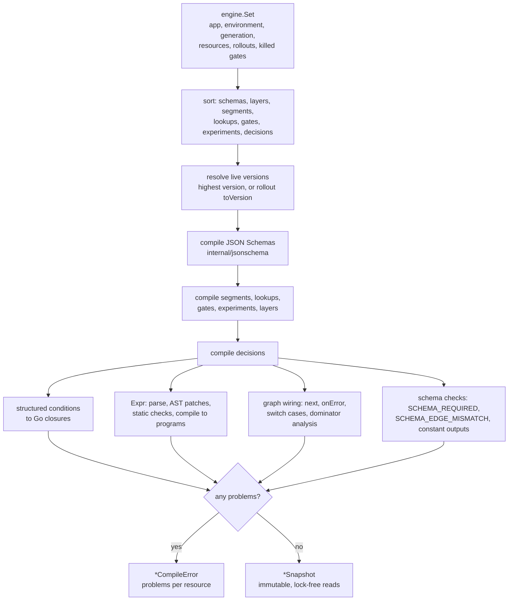
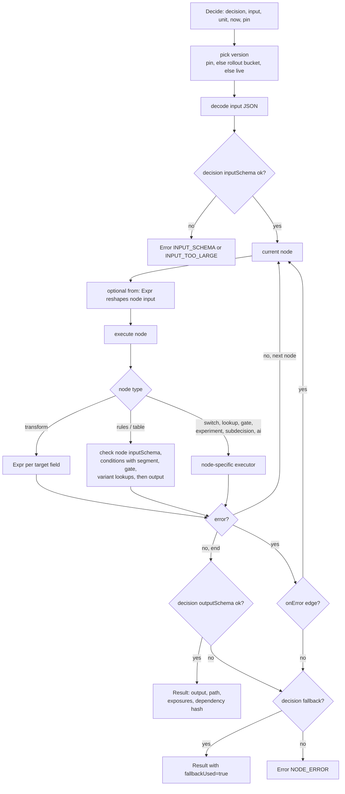

# engine — Gearbox decision engine

Module `github.com/ORG/gearbox/engine`. Pure Go, no I/O, no global state.
Implements the contract in `api.go` (used by the sidecar and the control plane)
and `bundle/api.go` (bundle writer/reader).

```
engine/
  api.go              contract (bodies delegate to the files below)
  spec.go             Go shapes of the definition model (OpenAPI components)
  builder.go          resource resolution, problem collection, caches
  decision.go         DecisionSpec compiler: graph shape, flow analysis, node wiring
  nodes.go            node compilers + executors (rules, table, transform, switch, lookup, gate, experiment, subdecision, ai, output)
  cond.go             structured conditions → Go closures (35 field operators, segment/gate/variant/expr leaves)
  expr.go, analyze.go Expr environment, AST patches, Gearbox functions, static analysis (paths, cost, PII taint)
  data.go             data slots ("=" expressions, "==" escape)
  values.go           runtime value helpers (numeric/string coercion, normalisation)
  resources.go        segments, lookups, gates, experiments, layers
  run.go              runtime: version pick/rollouts, graph execution, fallback, dependency hash
  compile.go          Compile/Set resolver, ValidateResource, Dependencies, schema helpers
  testing.go          RunTests, Benchmark;  meta.go: DecisionMeta, LogFields, DecideParsed, Fallback
  catalogue.go        Expr function catalogue (served by the control plane as GET /meta/expr)
  internal/hashing    murmur3 allocation hash (parity fixtures)
  internal/jsonschema compiled JSON Schema subset, compatibility, Accepts
  bundle/             protobuf + zstd + sha256 + Ed25519 bundles, offline file format
  testdata/lead_routing/set.json   the OpenAPI example set (5 schemas, 2 segments, lead_routing@17 with 6 tests)
```

## How it works

The engine has two phases. `Compile` turns an `engine.Set` (every resource
version of one app+environment) into an immutable `*Snapshot`; `Decide` then
evaluates requests against that snapshot without locks or I/O. The sidecar
calls `Compile` after it has verified a bundle; the control plane calls it when
validating drafts and before publishing.

### Compile pipeline



Validation and compilation are the same code path (`builder`), so
`ValidateResource` reports exactly what `Compile` would reject.

### Evaluation flow



An input-schema failure on the entry node is returned as `INPUT_SCHEMA` /
`INPUT_TOO_LARGE` to the caller; on any other node it is a node error and takes
the `onError` edge or the decision fallback. The sidecar adds a per-decision
circuit breaker on top (`Snapshot.Fallback`).

## Setup and run

The engine is a library; there is no binary. From the repository root:

```bash
# in a network-restricted sandbox first: source scripts/dev/restricted-env.sh
cd engine
go vet ./...
go test -race ./...                       # unit, lead_routing example, bundle, hashing parity fixtures
go test -run '^$' -fuzz FuzzDecide -fuzztime 30s .   # also FuzzSpecDecode, FuzzExprCompile
```

`make test` runs the same for every Go module. `make bench-engine` runs the
in-process micro-benchmarks (`bench_test.go`); measured numbers are in
[Benchmarks](../docs/07-benchmarks.md).

To try definitions without the control plane, run a sidecar on a definitions
directory (`make sidecar-offline`, see [sidecar/README.md](../sidecar/README.md)).

## Details


**Compile.** `Compile(set)` resolves every resource (live version = highest
version, or a rollout's `toVersion`), compiles it and fails with a
`*CompileError` listing problems per resource. Validation and compilation are
the same code path (`builder`), so `ValidateResource` reports exactly what
`Compile` would reject. A `Snapshot` is immutable; `Decide` reads it without
locks.

**Schema registry rule.** `rules` and `table` nodes need `inputSchema` and
`outputSchema` that resolve to registered versions (`SCHEMA_REQUIRED`,
`SCHEMA_NOT_FOUND`). At runtime the node input is validated against
`inputSchema` before any rule runs; on the entry node a failure is
`*engine.Error{Reason: "INPUT_SCHEMA" | "INPUT_TOO_LARGE", Fields}` (a
`maxItems` violation is `INPUT_TOO_LARGE`), elsewhere it is a node error
(`onError` / fallback). Constant `then`/`default` values are checked against
`outputSchema` at compile time; values containing `=` expressions at runtime.
`SCHEMA_EDGE_MISMATCH` is reported when a predecessor's declared output schema
is not accepted by a rules/table node's `inputSchema` (`jsonschema.Accepts`:
required properties, compatible types/enums, closed objects).

**Expressions** (expr-lang/expr v1.17.8). Variables: `input`, `request`,
`nodes`, `ctx` (`now`, `unit`, `requestId`, `env`), `out` (transforms),
`value` (table cells). AST patches: every member access is optional (missing
parents give nil), `< <= > >=` with nil are false, stateful functions get
`$env`. `now()` is disabled; `keys`/`values`/`toPairs` are sorted; `date()`
parses in UTC unless the string has an offset. Gearbox functions: `lookup`,
`inSegment`, `gate`, `variant`, `bucket` (nil without a unit), `daysBetween`,
`coalesce`. Static checks walk the AST: unknown variables, unknown field paths
against the schema in scope (`UNKNOWN_FIELD`, `TYPE_MISMATCH`), unknown
functions, literal resource names (`NAME_NOT_LITERAL`), `nodes.x` that may not
have run (`NODE_MAY_NOT_HAVE_RUN` warning, from a dominator analysis), cost
(loops over arrays without `maxItems` or nested worst case > 1e6 steps →
`COST_TOO_HIGH`) and PII taint.

**PII taint.** Paths marked `x-gearbox-pii` taint the request/node inputs;
taint flows through transforms (per target), data slots, `from`, subdecision
inputs. An AI `var` or a `logging.fields` entry that reads tainted data is
`PII_IN_PROMPT`.

**Conditions** compile to closures. Field semantics: missing or null field →
every operator false except `NOT_EXISTS`; numeric operators parse numeric
strings; `EQ` compares numbers numerically (and a numeric string with a number);
`BETWEEN` inclusive; `CONTAINS` = substring on strings, element on lists;
`CONTAINS_ANY/NONE` on lists (substring-any on strings); `MATCHES` RE2 compiled
once (`(?i)` for case-insensitive); `IS_TRUE/IS_FALSE` accept `"true"/"false"`.

**Hashing** (`internal/hashing`, parity with the previous experimentation
service, golden fixtures in `internal/hashing/testdata`):
`bucket = murmur3_32(frame(schemaVersion, tenant, scope, resourceID, assignmentVersion, salt, value)) * 10000 >> 32`
with uint32 big-endian length prefixes. Gearbox uses it with:

| Use | schemaVersion | tenant | scope | resourceID | assignmentVersion | salt | value |
|---|---|---|---|---|---|---|---|
| `bucket(salt)`, rule rollouts, rollout segments, gate rollouts, decision version rollouts | `1` | app | `rollout` | salt | `1` | `""` | unit (or segment key) |
| experiment variants | `1` | app | `experiment` | experiment name | `1` | experiment salt (default name) | unit |
| holdouts | `1` | app | `holdout` | experiment name | `1` | experiment salt | unit |
| layers | `1` | app | `layer` | layer name | `1` | layer salt (default name) | unit |

`bucket < percent*100` is "in". Default salts: rule rollout
`<decision>.<node>.<rule>`, gate rollout `<gate>.<rule>`, rollout segment = its
name, decision rollout `<decision>.rollout` when the control plane sends none.

**Experiments.** Order (parity): status (`draft`/`stopped` → `stopped`), no
unit (`no_unit`), holdout, layer allocation (`layer_conflict`), targeting
(`not_targeted`), variant ranges from cumulative weights. When not in the
experiment the result carries the default variant (`stoppedVariant`, else the
first) and its parameters, so callers always get a usable value. Exposures are
returned in `Result.Exposures` (deduplicated per call, only with a unit).

**Flow.** Entry → `next` (or `"end"`); no `next` ends the decision with the
node's output. Errors: `onError` edge (path outcome `fallback`,
`fallbackUsed=true`; the onError node receives the failed node's input) or the
decision `fallback` (outcome `error` on the failed node), else `NODE_ERROR`.
AI shadow nodes always take `onError` (outcome `shadow`, not a fallback) and
call the Hub in the background; inline nodes wait up to `timeoutMs` and
validate against `responseSchema`; `precompute` is rejected
(`NOT_IMPLEMENTED`). Dependency hash = `sha256:` over the sorted
`kind/name@version` lines of the decision version and everything it reads
transitively (killed gates included).

**Bundles** (`bundle/`): each resource is a deterministic `ResourceBlob`
(sorted members and rows) → zstd → sha256 content address; the manifest
(rollouts, killed gates, `min_engine_version = engine.Version`, `live=false`
for rollout "from" versions) is signed with Ed25519 over the exact bytes.
`Open` checks signature/trusted key, engine version, every hash and size, and
the decompressed cap. Offline file: `GBXBNDL1 | u32 len | envelope | u32 n |
n × (32-byte sha | u32 len | blob)`. `ParseTrustedKeys` accepts raw 32-byte or
PKIX-DER Ed25519 keys, comma- or newline-separated, `#` comments.

## Additions beyond the contract (exported, additive)

`CompileWithOptions` / `CompileOptions{PIIKey}`, `CompileError`,
`SegmentMemberHMAC`, `DefaultPIIKey`, `AIShadowRecorder`,
`Snapshot.DecideParsed`, `Snapshot.Fallback` (breaker), `Snapshot.DecisionMeta`,
`Snapshot.LogFields`, `Snapshot.App/Environment/Set`; bundle:
`EncodeResource`, `VerifyEnvelopeUnsigned`, `Inspect`, `SignatureKeyID`,
`CompareVersions`, error sentinels (`ErrSignature`, `ErrUnknownKey`, …),
`DefaultMaxDecompressed`, `ReleaseTypes`. Typed errors from `CheckGate`,
`GetVariant`, `CheckSegment` (`GATE_NOT_FOUND`, `EXPERIMENT_NOT_FOUND`,
`SEGMENT_NOT_FOUND`, `INVALID_ARGUMENT`, `NODE_ERROR`).

## Decisions made

- Version strings are `name@17` (`name@draft` for version 0).
- `kind` (DecisionInfo): a single rules/table/transform node → that type, else `graph`.
- Switch nodes pass their input through to the next node; `nodes.<switch>` is `{case}`.
- Gate/experiment node outputs: `{value, rule}` and `{variant, parameters, inExperiment, reason}` (camelCase).
- `all_matches` / `collect` output `{"matches": [...]}`; with no match `{"matches": []}` (rules: `[default]` when a default exists).
- A rules node with no match and no default is a node error.
- Field paths in structured conditions are relative to the node input (`car.price`, `items[0].x`).
- Unknown properties are `UNKNOWN_FIELD` when the object declares `properties` and does not set `additionalProperties: true`.
- AI prompt placeholders `{{ var }}`: strings are inserted raw, other values as JSON.
- Gate rules with a rollout are skipped without a unit; the result is then `no_unit` if nothing else matched.
- PII segment members: `hex(HMAC-SHA256(key, member))`, the same function the control plane uses; the sidecar passes `GEARBOX_HMAC_KEY_FILE` as `PIIKey` (default `DefaultPIIKey(app)` only for development).
- `gen/go` is required with the zero pseudo-version `v0.0.0-00010101000000-000000000000` and resolved by a `replace` to `../gen/go` (and by `go.work`). Replace both with a real version when modules are published.

## Known gaps

- Tables: `unique` overlap is detected at runtime (and therefore by test cases), not statically for ranges.
- AI `cache` and `budget` settings are parsed but not enforced (Hub enforces the hard budget).
- Expression type checks rely on Expr's checker with untyped input (`any`); arithmetic on optional fields is not rejected statically.
- The canonical-JSON / exposure-token fixtures of the previous service are not ported (Gearbox has no equivalent feature); the allocation, range and digest-frame fixtures are.
- Lead decision examples use `ctx.now`; tests without `ctx.now` use the wall clock.
