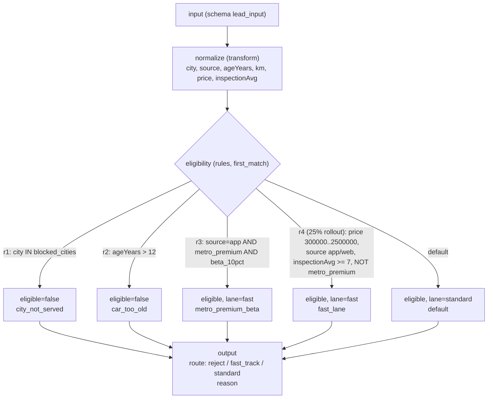

# Example definitions: `lead_service`

Definitions for the used-car lead example used throughout the docs. One file
per resource, in the shape described in
[docs/04-reference.md §10](../../docs/04-reference.md#10-definition-files-and-gearboxctl)
(engine `Resource`: `kind`, `name`, `version`, `description`, `spec`, plus
`segmentMembers` for static segments). Every `spec` matches the OpenAPI
component for its kind.

| File | Kind | What |
|---|---|---|
| `schemas/lead_input.yaml` | schema | Request input: nested lead and car, inspections array (`maxItems`), nullable names, PII phone |
| `schemas/eligibility_input.yaml` | schema | Flat shape built by the `normalize` transform |
| `schemas/eligibility_output.yaml` | schema | Output of the `eligibility` rules |
| `schemas/routing_output.yaml` | schema | Decision response |
| `schemas/segment_attrs_city_price.yaml` | schema | Attributes of the dynamic segment |
| `segments/blocked_cities.yaml` | static segment | Cities not served (`Leh`, `Kargil`, `Port Blair`) |
| `segments/metro_premium.yaml` | dynamic segment | Metro city (Delhi, Gurgaon, Mumbai, Bengaluru) and price > 800000, evaluated per call |
| `segments/beta_10pct.yaml` | rollout segment | Stable 10% of units |
| `decisions/lead_routing.yaml` | decision | transform → rules → output, with tests |

## How it works

`lead_routing` is a three-node graph. The input is validated against
`lead_input`, flattened by `normalize`, matched by the first-match rules in
`eligibility`, and mapped to a route by `output`. If a node fails, the
decision's own fallback `{route: manual_review, reason: fallback}` is returned
(`fallbackUsed: true`); input that does not match `lead_input` is an
`INPUT_SCHEMA` error instead.



Rules `r3` and `r4` depend on the unit ID (rollout buckets), so pass a stable
unit (the lead ID) when calling. The decision's `tests` avoid outcomes that
depend on a bucket; they run on the server (validation, change requests) and
in the sidecar before it swaps in a bundle.

## Setup and run

Serve them from a sidecar without a control plane (from the repository root);
`--watch` recompiles when a file changes:

```bash
GEARBOX_SOCKET=/tmp/gbx.sock \
  go run ./sidecar/cmd/gearbox-sidecar --definitions-dir examples/definitions --allow-unsigned --watch
# same as: make sidecar-offline   (socket .data/run/engine.sock)
```

Call them with the probe or any client:

```bash
go run ./examples/probe -target unix:///tmp/gbx.sock decide lead_routing examples/go-service/sample-lead.json -unit L-1029384
```

Push them to a server as drafts, then cut versions and publish as usual:

```bash
gearboxctl --server http://localhost:8080 --app lead_service push examples/definitions
```

`gearbox-server --seed` (used by `make dev`, `deploy/compose` and
`scripts/demo/live-demo.sh`) imports this directory, cuts version 1 of each
resource and publishes it to `dev`.
