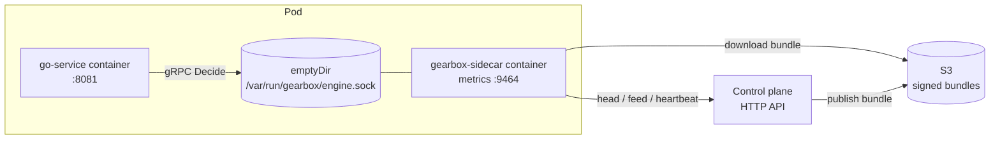
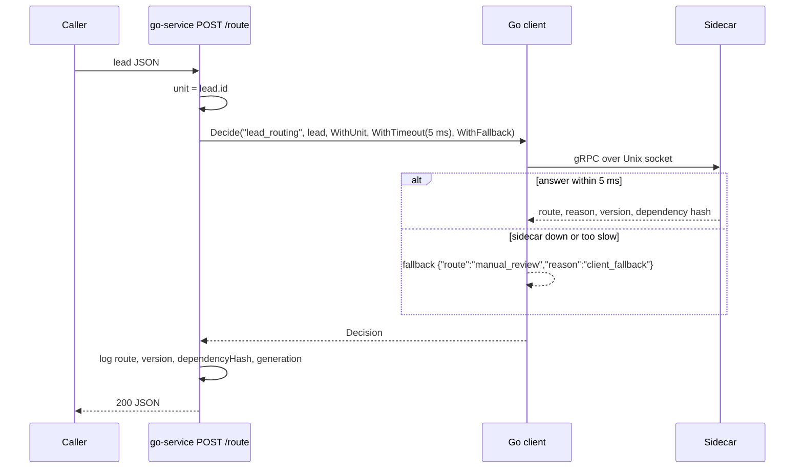

# Example: Go service calling the sidecar

A small HTTP service that asks the local Gearbox sidecar for the
`lead_routing` decision with a 5 ms deadline and a client-side fallback, and
logs the version and dependency hash with every routed lead.

| Endpoint | What |
|---|---|
| `POST /route` | Body: a lead (`lead_input` schema, see `sample-lead.json`). Returns `route`, `reason`, `version`, `dependencyHash`, `generation`, `fallbackUsed`, `fromClientFallback`. `422` when the input is rejected (for example `INPUT_SCHEMA`), `400` for invalid JSON. |
| `GET /healthz` | `204` |

| Variable | Default | Meaning |
|---|---|---|
| `GEARBOX_TARGET` | `unix:///var/run/gearbox/engine.sock` | Sidecar address |
| `EXAMPLE_ADDR` | `:8081` | HTTP listen address |

## How it works

In a pod, the service and the sidecar are two containers that share an
`emptyDir` volume holding the Unix socket. The sidecar syncs signed bundles
from the control plane, downloads the bundle bytes from S3 and answers
decisions in memory; the service only ever talks to the socket.



Request path:



## Setup and run

### Locally, without a control plane

From the repository root:

```bash
# 1. a sidecar serving the example definitions
mkdir -p .data/run
GEARBOX_SOCKET=$PWD/.data/run/engine.sock \
  go run ./sidecar/cmd/gearbox-sidecar --definitions-dir examples/definitions --allow-unsigned
# (same as: make sidecar-offline)

# 2. this service (second terminal)
cd examples/go-service
GEARBOX_TARGET=unix://$PWD/../../.data/run/engine.sock go run .
# or: go build -o go-service . && GEARBOX_TARGET=... ./go-service

# 3. a lead (third terminal, in examples/go-service)
curl -s -XPOST localhost:8081/route -d @sample-lead.json
# {"route":"standard","reason":"default","version":"lead_routing@1","dependencyHash":"sha256:…","generation":…,"fallbackUsed":false,"fromClientFallback":false}
```

Stop the sidecar and call again: the answer is
`{"route":"manual_review","reason":"client_fallback",…,"fromClientFallback":true}`
within the 5 ms deadline.

### Against a control plane

Run the sidecar with the control-plane settings instead of
`--definitions-dir` (names verified in `sidecar/internal/config`):

```bash
GEARBOX_SERVER_URL=http://127.0.0.1:8080 GEARBOX_APP=lead_service GEARBOX_ENV=dev \
GEARBOX_CREDENTIAL=gbx_cred_… GEARBOX_TRUSTED_KEYS_FILE=/path/to/trusted-keys.txt \
GEARBOX_SOCKET=$PWD/.data/run/engine.sock GEARBOX_CACHE_DIR=$PWD/.data/cache \
  go run ./sidecar/cmd/gearbox-sidecar
```

`DEV_EXAMPLE=1 make dev`, [deploy/compose](../../deploy/compose) and
[scripts/demo/live-demo.sh](../../scripts/demo) start this service for you. In
Kubernetes, add the sidecar to the pod with the
[gearbox-sidecar Helm library chart](../../deploy/helm/gearbox-sidecar).

### Container image

```bash
docker build -f deploy/docker/Dockerfile.example -t gearbox-example:dev .   # from the repository root
```

This is its own Go module with `replace` directives to `clients/go` and
`gen/go`; it is also listed in the root `go.work`.

For load testing, use [examples/probe](../probe) (`load` command); measured
numbers are in [docs/07-benchmarks.md](../../docs/07-benchmarks.md).
