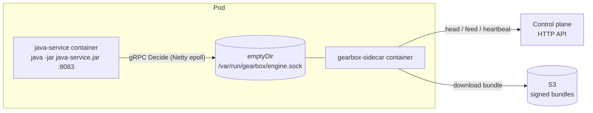
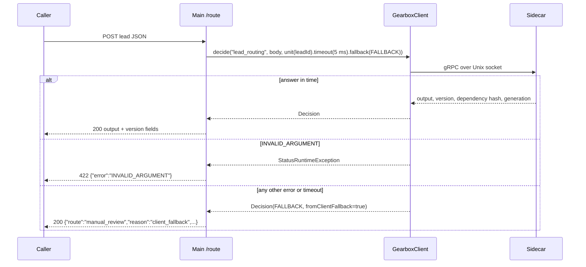

# Example: Java service calling the sidecar

`org.gearbox.example.Main` is a small HTTP service (JDK `HttpServer`, 8
worker threads) that asks the local sidecar for the `lead_routing` decision
through the [Gearbox Java client](../../clients/java), with a 5 ms deadline and
a client-side fallback. Started with `bench`, it measures Java client →
sidecar latency and throughput instead.

| Endpoint | What |
|---|---|
| `POST /route` | Body: a lead (`lead_input` schema). Returns the decision output plus `version`, `dependencyHash`, `generation`, `fallbackUsed`, `fromClientFallback`, `"service": "java"`. `422 {"error": "INVALID_ARGUMENT"}` when the input is rejected (e.g. `INPUT_SCHEMA`); `405` for other methods. |
| `GET /healthz` | `200 {"ok":true}` |

| Variable | Default | Meaning |
|---|---|---|
| `GEARBOX_TARGET` | `unix:///var/run/gearbox/engine.sock` | Sidecar address |
| `EXAMPLE_ADDR` | `127.0.0.1:8083` | HTTP listen address (`host:port`) |

## How it works



One `GearboxClient` is created at startup and shared by all request threads.
The unit ID is taken from `lead.id` in the body.



## Setup and run

Requirements: JDK 17+, Maven 3.9+.

### 1. Build

The example depends on `org.gearbox:gearbox-client:0.1.0-SNAPSHOT` from the
local Maven repository, so install the client first:

```bash
(cd clients/java && mvn -q install)          # generates stubs, runs the client tests, installs to ~/.m2
(cd examples/java-service && mvn -q package) # shaded jar: examples/java-service/target/java-service.jar
```

### 2. Start a sidecar

Without a control plane, from the repository root:

```bash
GEARBOX_SOCKET=/tmp/gbx.sock \
  go run ./sidecar/cmd/gearbox-sidecar --definitions-dir examples/definitions --allow-unsigned
```

Or connected to a control plane:

```bash
GEARBOX_SERVER_URL=http://127.0.0.1:8080 GEARBOX_APP=lead_service GEARBOX_ENV=dev \
GEARBOX_CREDENTIAL=gbx_cred_… GEARBOX_TRUSTED_KEYS_FILE=/path/to/trusted-keys.txt \
GEARBOX_SOCKET=/tmp/gbx.sock GEARBOX_CACHE_DIR=/tmp/gbx-cache \
  go run ./sidecar/cmd/gearbox-sidecar
```

### 3. Run the service

```bash
cd examples/java-service
GEARBOX_TARGET=unix:///tmp/gbx.sock java -jar target/java-service.jar
curl -s -XPOST localhost:8083/route -d @../go-service/sample-lead.json
```

### Benchmark mode

```bash
GEARBOX_TARGET=unix:///tmp/gbx.sock java -jar target/java-service.jar bench 5000 1,4,8
```

Arguments: total calls (default 5000) and thread counts (default `1,4,8`).
It makes 2,000 warm-up calls, then for each thread count splits the calls over
that many threads sharing one client (2 s deadline, no fallback) and prints one
JSON line with `calls`, `perMinute`, `p50Micros`, `p95Micros` and `p99Micros`.

Measured numbers are in [docs/07-benchmarks.md](../../docs/07-benchmarks.md).
[scripts/demo/live-demo.sh](../../scripts/demo) starts this jar on `:8083`
next to the Go and Python examples when it has been built.
