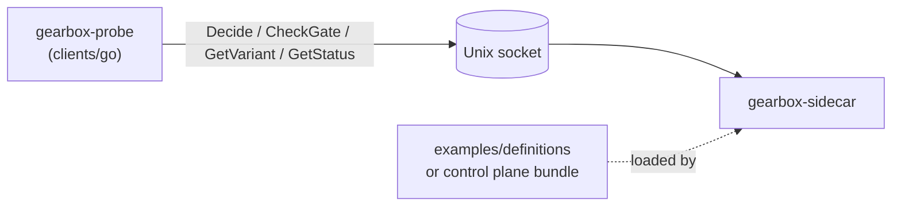
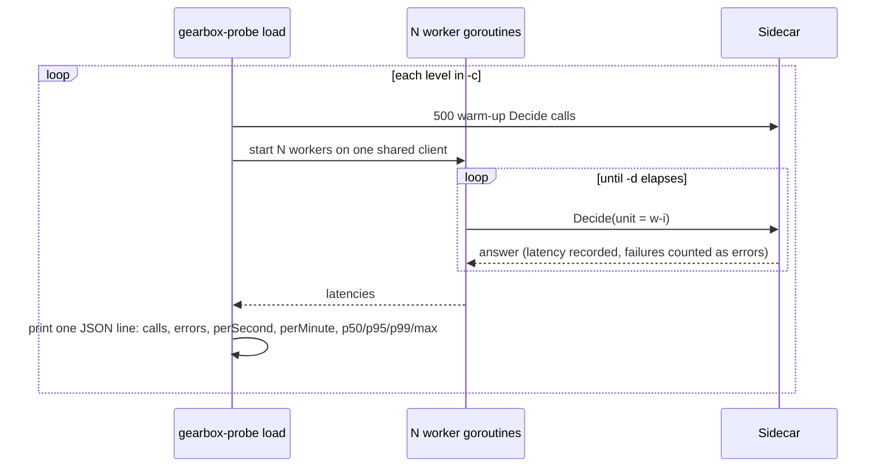

# gearbox-probe

A stand-alone command-line client for a Gearbox sidecar. It uses only the
public Go client ([clients/go](../../clients/go)), exactly like a service
would, and prints JSON so scripts can assert on it. It is also the load
generator behind the Go benchmarks.

```text
gearbox-probe [-target unix:///var/run/gearbox/engine.sock] <command> ...

  status                                         readiness, generation, sync state, decisions
  decide  <decision> <input.json|->  [-unit ID] [-now RFC3339]   one call, with per-node trace
  gate    <gate>                     [-unit ID]
  variant <experiment>                -unit ID
  bench   <decision> <input.json>    [-n 2000]                    sequential calls, one caller
  load    <decision> <input.json>    [-c 1,4,8,16] [-d 10s]       concurrent callers, one shared client
```

- `-target` is a global flag and must come **before** the command. Default:
  `GEARBOX_TARGET`, else `unix:///var/run/gearbox/engine.sock`. `host:port`
  targets are accepted, but the probe sends no bearer token, so the sidecar's
  TCP listener (which requires one) will reject it.
- Command flags may come before or after the positional arguments.
- Calls use a 2 s deadline (not the client's 5 ms default) and no fallback, so
  errors are reported, not hidden. The whole run is limited to 30 s for
  `status`/`decide`/`gate`/`variant`/`bench` (`load` is not).

## How it works



`bench` makes `-n` calls one after another, each with its own unit ID, and
prints `p50Micros`, `p95Micros`, `p99Micros` and `maxMicros`.

`load` runs once per concurrency level in `-c`:



## Setup and run

From the repository root (the probe is in `go.work`):

```bash
go build -o bin/gearbox-probe ./examples/probe
# or run it directly: go run ./examples/probe -target ... status
```

Start a sidecar to probe, for example on the example definitions:

```bash
GEARBOX_SOCKET=/tmp/gbx.sock \
  go run ./sidecar/cmd/gearbox-sidecar --definitions-dir examples/definitions --allow-unsigned
```

A sidecar connected to a control plane is configured with
`GEARBOX_SERVER_URL`, `GEARBOX_APP`, `GEARBOX_ENV`, `GEARBOX_CREDENTIAL`,
`GEARBOX_TRUSTED_KEYS_FILE`, `GEARBOX_SOCKET` and `GEARBOX_CACHE_DIR` instead
(see [docs/04-reference.md §2](../../docs/04-reference.md#2-sidecar-configuration)).

Then:

```bash
T=unix:///tmp/gbx.sock
bin/gearbox-probe -target $T status
bin/gearbox-probe -target $T decide lead_routing examples/go-service/sample-lead.json -unit L-1029384
echo '{"lead":{"id":"L-2","city":"Leh","source":"web"},"car":{"year":2021,"km":12000,"price":690000}}' \
  | bin/gearbox-probe -target $T decide lead_routing -
```

### Benchmark mode

```bash
bin/gearbox-probe -target $T bench lead_routing examples/go-service/sample-lead.json -n 5000
bin/gearbox-probe -target $T load  lead_routing examples/go-service/sample-lead.json -c 1,4,8,16 -d 10s
```

`make bench-sidecar` (`scripts/integration/bench-sidecar.sh`) builds the probe
and an isolated sidecar and runs `bench` three times. Measured numbers are in
[docs/07-benchmarks.md](../../docs/07-benchmarks.md).
