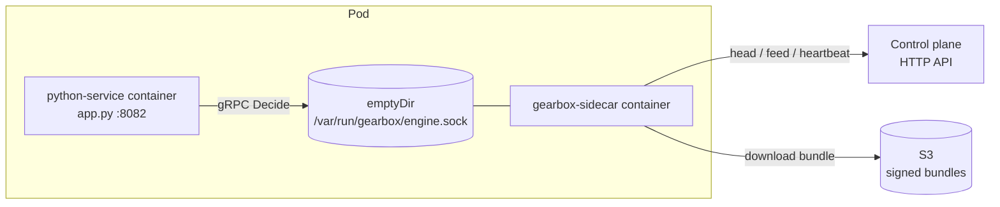
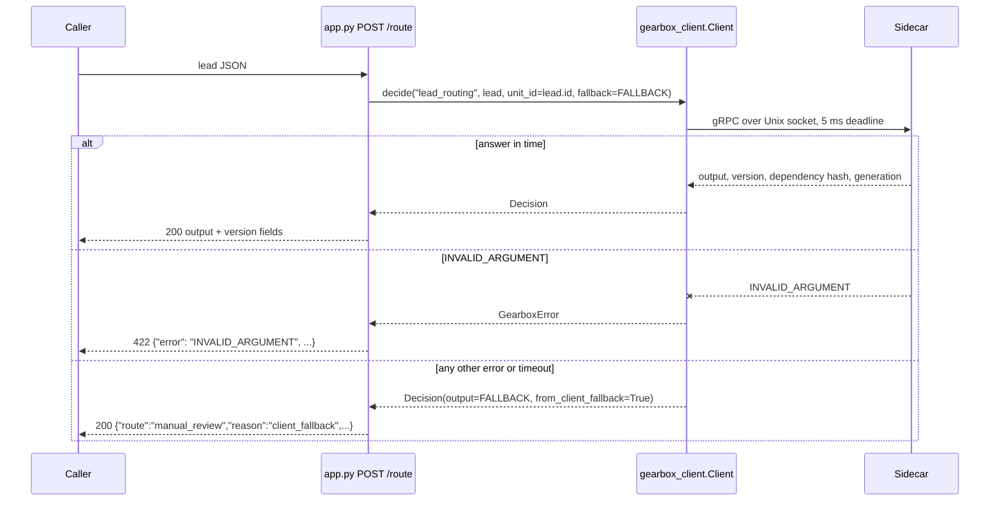

# Example: Python service calling the sidecar

`app.py` is a small HTTP service (standard library `ThreadingHTTPServer` plus
the [Gearbox Python client](../../clients/python)) that asks the local sidecar
for the `lead_routing` decision with a 5 ms deadline and a client-side
fallback. `bench.py` measures Python client → sidecar latency and throughput.

| Endpoint | What |
|---|---|
| `POST /route` | Body: a lead (`lead_input` schema). Returns the decision output plus `version`, `dependencyHash`, `generation`, `fallbackUsed`, `fromClientFallback`, `"service": "python"`. `422` with the gRPC code when the input is rejected (`INVALID_ARGUMENT`, e.g. `INPUT_SCHEMA`), `400` for invalid JSON. |
| `GET /healthz` | `200 {"ok": true}` |

| Variable | Default | Meaning |
|---|---|---|
| `GEARBOX_TARGET` | `unix:///var/run/gearbox/engine.sock` | Sidecar address |
| `EXAMPLE_ADDR` | `127.0.0.1:8082` | HTTP listen address (`host:port`) |

## How it works



One `Client` is created at import time and shared by all request threads.



## Setup and run

### 1. Install the client (generates the gRPC stubs)

From the repository root:

```bash
python3 -m venv .venv && . .venv/bin/activate
pip install grpcio protobuf grpcio-tools
clients/python/scripts/gen.sh          # stubs are not committed
pip install -e clients/python
```

### 2. Start a sidecar

Without a control plane, from the example definitions:

```bash
GEARBOX_SOCKET=/tmp/gbx.sock \
  go run ./sidecar/cmd/gearbox-sidecar --definitions-dir examples/definitions --allow-unsigned
```

Or connected to a control plane:

```bash
GEARBOX_SERVER_URL=http://127.0.0.1:8080 GEARBOX_APP=lead_service GEARBOX_ENV=dev \
GEARBOX_CREDENTIAL=gbx_cred_… GEARBOX_TRUSTED_KEYS_FILE=/path/to/trusted-keys.txt \
GEARBOX_SOCKET=/tmp/gbx.sock GEARBOX_CACHE_DIR=/tmp/gbx-cache \
  go run ./sidecar/cmd/gearbox-sidecar
```

### 3. Run the service

```bash
GEARBOX_TARGET=unix:///tmp/gbx.sock EXAMPLE_ADDR=127.0.0.1:8082 python examples/python-service/app.py
curl -s -XPOST localhost:8082/route -d @examples/go-service/sample-lead.json
```

### Benchmark mode

```bash
python examples/python-service/bench.py --target unix:///tmp/gbx.sock --calls 5000 --threads 1,4,8
```

- `--target` defaults to `unix:///tmp/gbx.sock` (it does not read `GEARBOX_TARGET`).
- For each thread count it splits `--calls` over the threads (each thread uses its own
  `Client`, 2 s deadline, no fallback) and prints one JSON line with `calls`,
  `perMinute`, `p50Micros`, `p95Micros`, `p99Micros` and `meanMicros`.

Measured numbers are in [docs/07-benchmarks.md](../../docs/07-benchmarks.md).
[scripts/demo/live-demo.sh](../../scripts/demo) starts this service on `:8082`
next to the Go and Java examples.
