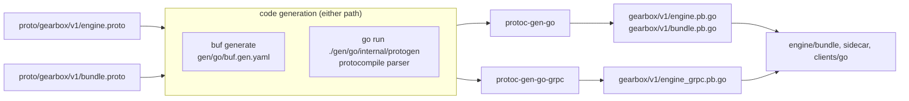

# gen/go — generated Go code for the Gearbox protos

Module `github.com/ORG/gearbox/gen/go`, package `gearboxv1`
(`github.com/ORG/gearbox/gen/go/gearbox/v1`), generated from
`proto/gearbox/v1/engine.proto` and `proto/gearbox/v1/bundle.proto`.

| File | From |
|---|---|
| `gearbox/v1/engine.pb.go` | messages of `engine.proto` (protoc-gen-go v1.36.10) |
| `gearbox/v1/engine_grpc.pb.go` | `EngineService` client and server: `Decide`, `DecideBatch`, `CheckGate`, `GetVariant`, `GetStatus` (protoc-gen-go-grpc v1.5.1) |
| `gearbox/v1/bundle.pb.go` | bundle messages (`SignedManifest`, `Manifest`, `ResourceBlob`, …) |

The generated code is committed, so importers need no code generator. Inside
the monorepo the module is resolved through `go.work` and the `replace`
directives in each module's `go.mod` (`github.com/ORG` is a placeholder path).

Importers: `engine/bundle` (bundle wire format), `sidecar/internal/server` and
`sidecar/internal/app` (gRPC server), `clients/go` (gRPC client).

## How it works



Both paths run the same two plugins at the versions pinned in `gen/go/go.mod`,
so the output is identical to the committed files.

## Setup and run

Standard path (any machine with `buf` and the two plugins on `PATH`), from the
repository root:

```bash
buf generate proto --template gen/go/buf.gen.yaml
buf lint proto                                              # STANDARD rules
buf breaking proto --against '.git#branch=main,subdir=proto' # FILE rules
```

`buf.yaml` and `buf.gen.yaml` live in this directory because `proto/` is owned
by the contracts lead.

Without `buf`/`protoc` (for example in a network-restricted sandbox):

```bash
# in a restricted sandbox first: source scripts/dev/restricted-env.sh
go run ./gen/go/internal/protogen -proto proto -out gen/go -moddir gen/go
```

`internal/protogen` parses the protos with `github.com/bufbuild/protocompile`,
builds a `CodeGeneratorRequest` like protoc does, builds the real
`protoc-gen-go` and `protoc-gen-go-grpc` plugins from this module's graph
(`go build`) and runs them. The header of the generated files says
`protoc v5.29.0`; that is the compiler version the tool reports to the plugins
(no protoc is involved).

After regenerating, `make vet test` checks every module that imports the code.

`make gen` runs the protogen command above and regenerates the UI API client.

## Decisions

- The codegen tool lives inside this module (`internal/protogen`) rather than
  in a separate `tools/` module so it shares the pinned plugin versions and the
  workspace; its extra requirements (`protocompile`, `protoc-gen-go-grpc`) are
  never compiled into importers.
- `go.sum` is committed. If it drifts (for example after changing plugin
  versions), run `go mod tidy` in this module on a machine with normal module
  proxy access; inside the restricted sandbox vanity paths
  (`google.golang.org/...`) resolve to GitHub mirrors whose hashes differ.
