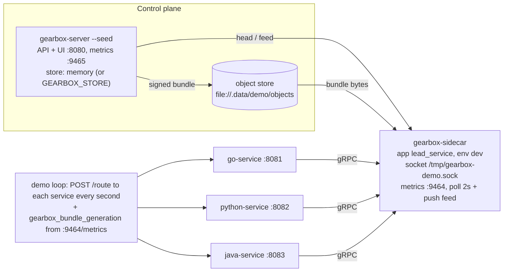
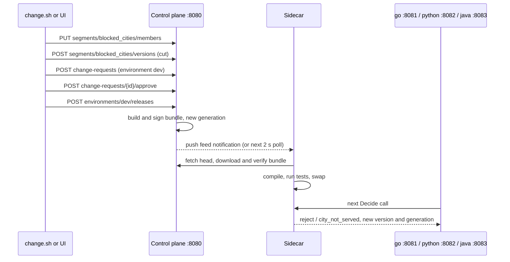

# Live demo

Shows a control-plane change reaching three services written in Go, Python
and Java within seconds, all through one sidecar.

| Script | What |
|---|---|
| `live-demo.sh` | Builds and starts the control plane (with the UI if built), one sidecar and the three example services, then prints every service's answer for the same lead once a second. Ctrl-C stops everything. |
| `change.sh block\|unblock <City>` | Makes a real change through the admin API (the same calls the UI makes): replace `blocked_cities` members → cut a version → open a change request → approve → publish to `dev`. |
| `ui_demo.py` | Does the same change by driving the real admin UI in headless Chromium (Playwright), measures how long each service takes to change its answer, and saves screenshots, a video and a log. |

## How it works

`live-demo.sh` starts (logs in `.data/demo/*.log`):



1. `go build` of `gearbox-server`, `gearboxctl`, `gearbox-sidecar` and
   `examples/go-service` into `bin/`; `gearboxctl keys generate` creates a demo
   signing key in `.data/demo/keys` (kept between runs).
2. The server starts with `--seed`: it creates app `lead_service` from
   `examples/definitions`, publishes generation 1 to `dev` and registers the
   demo credential.
3. The sidecar syncs from the server (`GEARBOX_SERVER_URL`, `GEARBOX_APP`,
   `GEARBOX_ENV`, `GEARBOX_CREDENTIAL`, `GEARBOX_TRUSTED_KEYS_FILE`,
   `GEARBOX_SOCKET`, `GEARBOX_CACHE_DIR`, `GEARBOX_POLL_INTERVAL=2s`).
4. The Go service always starts. The Python service starts only if
   `python3 -c "import gearbox_client"` works; the Java service only if
   `examples/java-service/target/java-service.jar` exists. Otherwise the
   script prints `skipped` and that column shows `-`.

A publish, from either `change.sh` or the UI, flows through like this:



## Setup and run

Needs Go 1.24+ and `curl`; `python3` is used by the demo loop and by
`change.sh`. Optional parts:

```bash
# admin UI (without ui/build the server runs API-only)
(cd ui && npm ci && npm run build)

# Python service: the client must be importable by the python3 that runs the script
python3 -m venv .venv && . .venv/bin/activate
pip install grpcio protobuf grpcio-tools
clients/python/scripts/gen.sh && pip install -e clients/python

# Java service (JDK 17+, Maven 3.9+)
(cd clients/java && mvn -q install) && (cd examples/java-service && mvn -q package)
```

Start the demo (from the repository root, with the venv active if you use it):

```bash
scripts/demo/live-demo.sh
```

| Variable | Default | Effect |
|---|---|---|
| `GEARBOX_STORE` | `memory` | e.g. `mongodb://localhost:27017/?directConnection=true` (database `GEARBOX_MONGO_DB`, default `gearbox_demo`) |
| `GEARBOX_OBJECT_STORE` | `file://.data/demo/objects` | Where bundles are stored |
| `GEARBOX_DEMO_SOCK` | `/tmp/gearbox-demo.sock` | Sidecar socket (keep it short: ~104-byte limit) |
| `DEMO_INTERVAL` / `DEMO_TICKS` | `1` / `100000` | Seconds between lines / number of lines |
| `GEARBOX_RESTRICTED` | `0` | `1` sources `scripts/dev/restricted-env.sh` |

The script uses fixed ports 8080, 9465, 9464, 8081, 8082 and 8083; they must be free.

Make a change from another terminal and watch the three columns flip from
`standard/default` to `reject/city_not_served` with a new version:

```bash
scripts/demo/change.sh block Indore
scripts/demo/change.sh unblock Indore
```

`change.sh` reads `GEARBOX_API` (default `http://127.0.0.1:8080/api/v1`) and
`GEARBOX_ENV` (default `dev`).

Or do it in the UI at http://127.0.0.1:8080 (no sign-in): Segments →
`blocked_cities` → add Indore → Versions → cut → Change requests → publish to
dev. To script the UI path and record it:

```bash
pip install playwright && python -m playwright install chromium
python scripts/demo/ui_demo.py --out .data/demo/ui      # --city Indore by default
```

`ui_demo.py` replaces the segment members with `Leh, Kargil, Port Blair` plus
`--city`, so run it against freshly seeded data. Screenshots
(`01-overview.png` … `08-segment-members.png`), the video and `ui-demo.log`
go to `--out`.

Propagation timings measured with `scripts/integration/bench-propagation.sh`
are in [docs/07-benchmarks.md](../../docs/07-benchmarks.md).
