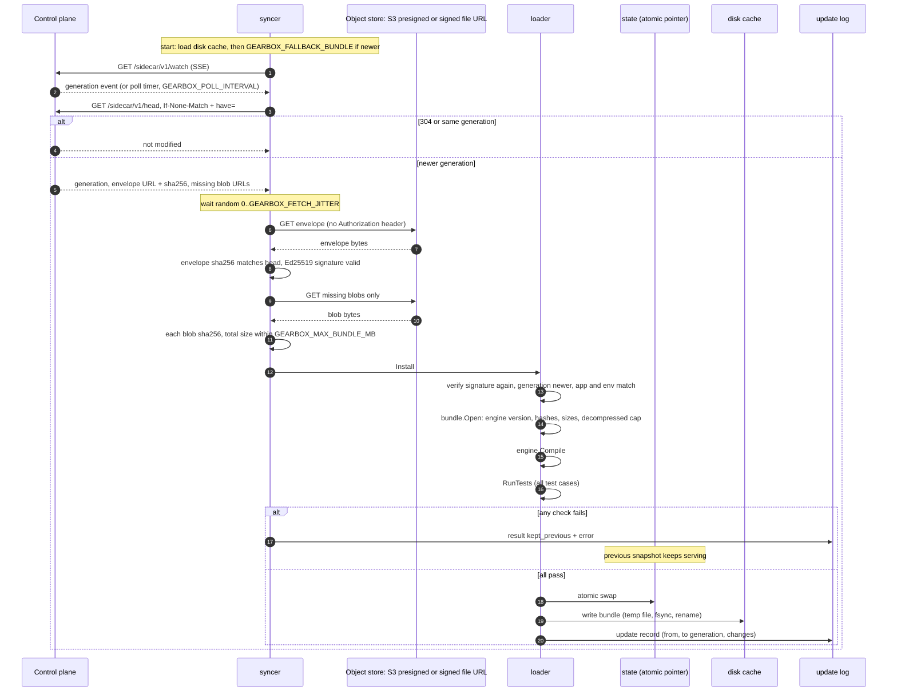
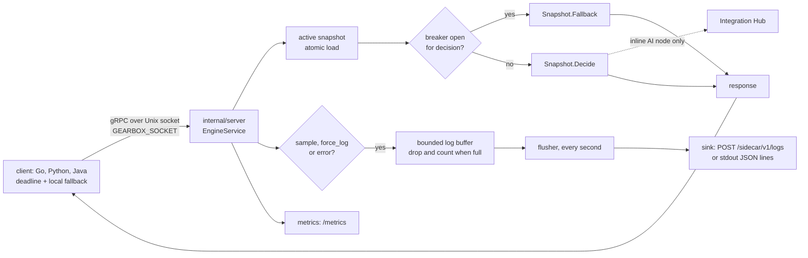

# sidecar — gearbox-sidecar

Module `github.com/ORG/gearbox/sidecar`, binary `cmd/gearbox-sidecar`. Serves
`gearbox.v1.EngineService` (proto/gearbox/v1/engine.proto) next to an
application, keeps its bundle current from the control plane, and ships logs,
metrics and heartbeats.

```
gearbox-sidecar                                   # online: sync from GEARBOX_SERVER_URL
gearbox-sidecar --bundle-file f.bundle [--allow-unsigned]
gearbox-sidecar --definitions-dir ./defs --watch --allow-unsigned
gearbox-sidecar healthcheck                       # exit 0 when /readyz is OK (distroless images)
gearbox-sidecar version
```

## How it works

The sidecar holds one active `engine.Snapshot` behind an `atomic.Pointer`.
Requests read it without locks; a background loop replaces it when the control
plane publishes a new generation. A bundle becomes active only after it has
been verified, compiled and has passed all its test cases; otherwise the
previous one keeps serving.

### Sync and swap



### Request path



Exposure and update records skip sampling and go through the same buffers.

## Setup and run

Build from the repository root (`make build` builds all three binaries into
`bin/`):

```bash
# in a network-restricted sandbox: source scripts/dev/restricted-env.sh (or GEARBOX_RESTRICTED=1 make ...)
go build -o bin/ ./sidecar/cmd/gearbox-sidecar
```

Offline, on the example definitions (no control plane):

```bash
make sidecar-offline
# same as:
GEARBOX_SOCKET=$PWD/.data/run/engine.sock \
  go run ./sidecar/cmd/gearbox-sidecar --definitions-dir examples/definitions --allow-unsigned --watch
```

Online, against a local control plane: `make dev` starts `gearbox-server`
(memory store, `GEARBOX_AUTH_MODE=dev`, seeded `lead_service`) and a sidecar on
`.data/run/engine.sock` with a dev credential and the generated trusted key. By
hand, with a server already running:

```bash
GEARBOX_SERVER_URL=http://localhost:8080 GEARBOX_APP=lead_service GEARBOX_ENV=dev \
GEARBOX_CREDENTIAL='<sidecar credential printed by gearbox-server seed --demo, or created in the UI>' \
GEARBOX_TRUSTED_KEYS='<trusted key line printed by seed or keygen>' \
GEARBOX_SOCKET=$PWD/.data/run/engine.sock GEARBOX_CACHE_DIR=$PWD/.data/cache \
  bin/gearbox-sidecar
```

`GEARBOX_AUTH_MODE=dev` applies to the control plane only; the sidecar always
authenticates with its app credential.

Tests: `cd sidecar && go test -race ./...`. Client → socket → sidecar latency
is measured by `make bench-sidecar`; see [Benchmarks](../docs/07-benchmarks.md)
for measured numbers.

## Details

Package layout:

```
internal/app        wiring, listeners, shutdown          internal/server   EngineService, interceptors
internal/config     GEARBOX_* env + flags, validation    internal/state    atomic active snapshot
internal/syncer     loader (verify→open→compile→tests→swap→cache), head/SSE sync, heartbeat
internal/logs       non-blocking buffers + sinks (stdout JSON lines, POST /sidecar/v1/logs)
internal/metrics    dependency-free Prometheus registry  internal/obs      metric definitions
internal/breaker    per-decision circuit breaker         internal/hub      Integration Hub AICaller
internal/defs       YAML/JSON definitions directory
sidecartest/        start an in-process sidecar from an engine.Set (for client/app tests)
```

- **Serving.** gRPC on a Unix socket (`GEARBOX_SOCKET`, mode `0660`; a stale
  socket file is replaced, a live one is refused) and optionally loopback TCP
  (`GEARBOX_TCP_ADDR`, must be a loopback address, requires
  `authorization: Bearer <GEARBOX_TCP_TOKEN_FILE>`). `grpc.health.v1` reports
  `SERVING` only once a verified bundle is active. Reflection with
  `GEARBOX_REFLECTION=true`. Each RPC gets a server-side timeout
  (`GEARBOX_RPC_TIMEOUT`, default 11 s, above the 10 s AI maximum). Errors are
  canonical codes with `google.rpc.ErrorInfo` (domain `gearbox.dev`, reasons
  `DECISION_NOT_FOUND`, `INPUT_SCHEMA`, `INPUT_TOO_LARGE`, `NODE_ERROR`,
  `NOT_READY`, `GATE_NOT_FOUND`, `EXPERIMENT_NOT_FOUND`, `INVALID_ARGUMENT`,
  metadata `node`) plus `BadRequest` field violations for schema errors.
  `pin_version` accepts `17`, `v17` or `name@17`. `DecideBatch` ≤ 100 items,
  per-item `ItemError`.
- **The request path never waits on the network** (except inline AI nodes,
  bounded by their timeout): it reads the active snapshot from an
  `atomic.Pointer`.
- **Sync loop.** Calls `GEARBOX_SERVER_URL + /api/v1/sidecar/v1/head` with
  `If-None-Match` and `have=` (hashes already held) on start, every
  `GEARBOX_POLL_INTERVAL`, and after each `generation` event of the SSE feed
  `/api/v1/sidecar/v1/watch` (reconnect with 1 s → 60 s backoff ±20 %, dead
  stream after 45 s without data). Failures back off 1 s → 60 s. Before
  fetching a new generation it waits a random 0–`GEARBOX_FETCH_JITTER` (2 s).
  Envelope and blob URLs are self-authenticating and get **no**
  `Authorization` header; relative URLs are resolved against the API base. It
  checks the envelope hash from the head, verifies the signature
  (`GEARBOX_TRUSTED_KEYS`), downloads only missing blobs (hash and
  `GEARBOX_MAX_BUNDLE_MB` checked), then `bundle.Open` (generation strictly
  greater, `min_engine_version`, hashes, sizes, decompressed cap 4×),
  `engine.Compile`, **all test cases** — any failure keeps the previous bundle
  — and swaps. A rejected bundle is not downloaded again until the head
  changes.
- **Last-known-good.** After each network swap the bundle is written
  atomically (temp file, fsync, rename, dir fsync) to
  `GEARBOX_CACHE_DIR/<app>-<env>.bundle`. On start it is re-verified and
  loaded (`loaded_from_disk`), then `GEARBOX_FALLBACK_BUNDLE` (only if newer),
  then sync. Unsigned bundles are never accepted from the network.
- **Offline.** `--bundle-file` (signed, or `--allow-unsigned`);
  `--definitions-dir` compiles a directory of YAML/JSON definitions (formats in
  `internal/defs`; engine form `{kind, name, version, spec}` or manifest form
  `{apiVersion, kind: Decision, metadata, spec}`, plus an optional
  `{app, environment, rollouts, killedGates}` document) into an unsigned
  bundle; `--watch` recompiles on change (1 s polling), each reload is a new
  local generation, failing tests keep the previous version.
- **Logs.** Decision records (sampled: decision `logging.sample`, else
  `GEARBOX_LOG_SAMPLE`; always for `force_log` and errors), update records and
  exposure records (never sampled) go into bounded buffers; when full, records
  are dropped and counted (`gearbox_log_dropped_total{log}`); one goroutine
  flushes batches (≤ `GEARBOX_LOG_BATCH`, every second). Input/output are
  represented by `hmac:` HMAC-SHA256 under the installation key; only
  `logging.fields` appear in clear (PII fields are rejected at validation).
  Inline AI calls appear in `ai[]` (node, model, latency, answer hash, result).
- **Metrics** on `GEARBOX_METRICS_ADDR` (`/metrics`, `/livez`, `/readyz`):
  `gearbox_decisions_total{decision,version,status,fallback}`,
  `gearbox_decision_duration_seconds`, `gearbox_node_errors_total`,
  `gearbox_bundle_generation`, `gearbox_sync_lag_seconds`,
  `gearbox_sync_failures_total{reason}`, `gearbox_swap_duration_seconds`,
  `gearbox_ai_calls_total{decision,node,mode,result}` (`mode="call"` for every
  Hub call, `mode="shadow"` for shadow outcomes incl. `schema_invalid`),
  `gearbox_ai_duration_seconds`, `gearbox_log_dropped_total`,
  `gearbox_decision_breaker_open_total`, `gearbox_inflight_requests`, plus
  `gearbox_exposures_total` and `gearbox_updates_total{result}`.
- **Circuit breaker.** A decision whose evaluation exceeds 10 × `budgetMicros`
  on 5 consecutive calls answers with its fallback (`Snapshot.Fallback`, path
  outcome `breaker_open`) for 30 s, then is evaluated again.
- **Hub client** (`internal/hub`, placeholder contract):
  `POST {GEARBOX_HUB_URL}/v1/ai/completions`, bearer token from
  `GEARBOX_HUB_TOKEN_FILE` (re-read every minute), `Idempotency-Key` = call ID,
  `timeout_ms` = node timeout − 10 % (min 10 ms), metadata decision/node/
  call_id/request_id, `sony/gobreaker` (opens after 5 consecutive failures for
  30 s). Only this package changes when the Hub's real contract arrives.
- **Heartbeat** `POST /api/v1/sidecar/v1/heartbeat` every
  `GEARBOX_HEARTBEAT_INTERVAL` with generation, last sync, p99 (from the
  duration histogram), calls per minute, fallback rate.
- **Shutdown.** SIGTERM/SIGINT: health goes `NOT_SERVING`, gRPC drains within
  `GEARBOX_SHUTDOWN_GRACE`, the socket is removed, logs are flushed.
  `GOMAXPROCS` is left to the Go runtime (set it from the CPU request).

## Configuration

Names follow docs/04-reference.md.

| Variable | Default | Meaning |
|---|---|---|
| `GEARBOX_SERVER_URL` | – | Control plane base URL; the sidecar calls `<url>/api/v1/sidecar/v1/*` (a URL already ending in `/api/v1` is used as is) |
| `GEARBOX_APP`, `GEARBOX_ENV` | – (offline: `local`/`dev`) | Bundles for another app/env are rejected |
| `GEARBOX_CREDENTIAL_FILE` / `GEARBOX_CREDENTIAL` | – | App credential |
| `GEARBOX_TRUSTED_KEYS_FILE` / `GEARBOX_TRUSTED_KEYS` | – | `key_id:base64` (raw or PKIX Ed25519), per line or comma-separated |
| `GEARBOX_SOCKET` | `/var/run/gearbox/engine.sock` | Unix socket (0660) |
| `GEARBOX_TCP_ADDR`, `GEARBOX_TCP_TOKEN_FILE` | off | Loopback TCP (`127.0.0.1`, `::1` or `localhost`) + bearer token file (required with the address) |
| `GEARBOX_REFLECTION` | `false` | gRPC reflection |
| `GEARBOX_METRICS_ADDR` | `:9464` | metrics and probes |
| `GEARBOX_CACHE_DIR` | `/var/cache/gearbox` | last-known-good bundle |
| `GEARBOX_FALLBACK_BUNDLE` | – | bundle file served at start when nothing newer is available |
| `GEARBOX_POLL_INTERVAL` | `30s` | head poll (≥ 1 s) |
| `GEARBOX_FEED` | `true` | SSE change feed |
| `GEARBOX_FETCH_JITTER` | `2s` | random delay before fetching a new generation |
| `GEARBOX_HEARTBEAT_INTERVAL` | `30s` | heartbeats (0 disables) |
| `GEARBOX_SIDECAR_ID` | `POD_NAME`, else hostname | ID in heartbeats/logs |
| `GEARBOX_NODE_NAME` | `NODE_NAME` | node in heartbeats |
| `GEARBOX_MAX_BUNDLE_MB` | `64` | compressed bundle limit (decompressed 4×) |
| `GEARBOX_MAX_INPUT_BYTES` | `262144` | input limit (`INPUT_TOO_LARGE`) |
| `GEARBOX_LOG_SINK` | `server` online, `stdout` offline | `stdout`, `server` (alias `http`), `both`, `none`, `otlp` (not implemented: falls back to stdout). `server`/`both` need `GEARBOX_SERVER_URL` and a credential |
| `GEARBOX_LOG_SAMPLE` | `0.01` | default decision-log sampling |
| `GEARBOX_LOG_BUFFER` | `65536` | buffer size (records) |
| `GEARBOX_LOG_BATCH` | `1000` | records per upload |
| `GEARBOX_HMAC_KEY_FILE` / `GEARBOX_HMAC_KEY` | derived from the app name (warns) | installation key shared with the control plane: log HMACs and `pii` segment lookups; a path or the value, trimmed |
| `GEARBOX_OTLP_ENDPOINT` | – | not implemented (warning) |
| `GEARBOX_HUB_URL`, `GEARBOX_HUB_TOKEN_FILE` | – | Integration Hub (AI nodes) |
| `GEARBOX_SHUTDOWN_GRACE` | `10s` | drain time |
| `GEARBOX_RPC_TIMEOUT` | `11s` | server-side RPC deadline |
| `GEARBOX_LOG_LEVEL` | `info` | sidecar's own logs (JSON on stderr) |

## Tests

`internal/app/e2e_test.go`: builds signed bundles with `engine/bundle`, serves
them from an `httptest` fake control plane (head with ETag, self-authenticating
blob URLs, SSE watch, heartbeat), starts the sidecar in process, calls
Decide/DecideBatch/GetStatus/health over the real Unix socket, publishes
generation 43 through the feed and asserts the swap and its update record, then
rejects a tampered envelope (signature `invalid`), an older generation behind a
newer head, and a bundle whose tests fail; checks metrics, readyz, decision
logs, heartbeats, that PII never appears in logs, socket removal on shutdown,
and a restart that serves the last-known-good bundle with the control plane
down. `offline_test.go` covers `--definitions-dir --watch`. Also verified
manually against the real control plane (`gearbox-server serve --seed`):
sync + verify, Decide, heartbeat in the fleet view, decision and update logs.

## Decisions and known gaps

- Prometheus exposition is implemented in `internal/metrics` (≈250 lines)
  instead of pulling `prometheus/client_golang` and its dependency tree.
- OTLP export (logs and traces) is not implemented; traces are not emitted.
  The caller's `traceparent` is read and its trace ID written to decision logs.
- `koanf` is not used: configuration is plain `GEARBOX_*` environment parsing
  with validation and clear errors.
- The AI calls-per-minute budget and per-pod answer cache are not implemented.
- Shadow AI outcomes are counted in metrics and logged at debug level; they do
  not appear in the decision record (they finish after it is written).
- `--watch` polls every second (no fsnotify dependency).
- Hub client, breaker, defs, logs and server have focused tests; the server and
  syncer are mainly covered by the end-to-end test.
