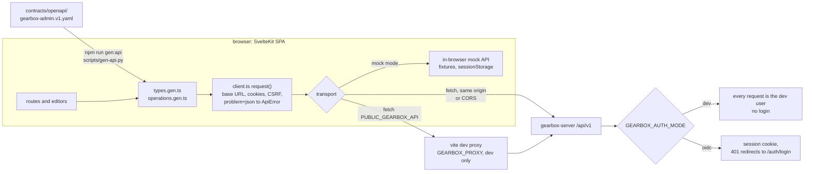
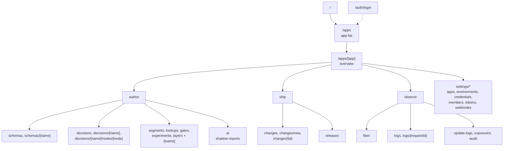

# Gearbox admin UI

The admin console for Gearbox: register schemas, build decisions (rule sets, tables, transforms and graphs),
manage segments, lookups, gates, experiments and layers, review change requests, publish releases, and watch
the sidecar fleet and logs. It is a SvelteKit 2 + Svelte 5 single-page app built to static files, and it talks
only to the control-plane HTTP API described in [`contracts/openapi/gearbox-admin.v1.yaml`](../contracts/openapi/gearbox-admin.v1.yaml).

`prototype/index.html` is the clickable HTML prototype the design was ported from.

## How it works



Every screen calls the generated operation functions; there is no ad-hoc
`fetch`. The mock implements the same generated `Ops` map, so it is
type-checked against the contract. Mock mode is on with `PUBLIC_GEARBOX_MOCK=1`
and switches on by itself in `npm run dev` when the API does not answer.

Route map (all app screens live under `/apps/[app]`, environment in `?env=`):



## Setup and run

Requires Node.js 20.19 or newer.

```sh
cd ui
npm install
```

### Run with sample data (no backend)

```sh
npm run dev:mock          # PUBLIC_GEARBOX_MOCK=1: always use the in-browser mock API
```

`npm run dev` also falls back to the sample data by itself when no API answers (only in dev). A **Sample data**
badge in the top bar shows that the mock is in use.

The mock implements every operation in the contract over realistic fixtures: app `lead_service` (and a small
`pricing_api`), schemas `lead_input`, `eligibility_input`, `eligibility_output`, `routing_output`,
`segment_attrs_city_price` and more, the `lead_routing` graph from the OpenAPI example, segments
`blocked_cities` (static), `metro_premium` (dynamic) and `beta_10pct` (rollout), lookups, gates, experiments,
a layer, change requests, releases, the sidecar fleet and decision, update, exposure and audit logs. It
evaluates decisions with a small Expr evaluator, runs test cases, validates specs (including
`422 SCHEMA_REQUIRED`/`SCHEMA_NOT_FOUND` on save), checks schema compatibility and applies releases, rollouts,
rollbacks and kill switches. Edits persist in `sessionStorage` for the tab. The account menu has **Act as**
(switch between the sample members to try roles and self-approval rules) and **Reset sample data**.

### Run against a control plane

Start a local server in dev auth mode first (from the repository root, see
[controlplane/README.md](../controlplane/README.md)):

```sh
GEARBOX_AUTH_MODE=dev bin/gearbox-server serve --seed     # :8080, seeded lead_service, no login
```

Then:

```sh
GEARBOX_PROXY=http://localhost:8080 npm run dev     # dev server proxies /api to the control plane (same origin, cookies work)
# or
PUBLIC_GEARBOX_API=https://gearbox.example.com/api/v1 npm run dev   # cross-origin: the server needs GEARBOX_UI_ORIGIN set to the UI origin (CORS with credentials)
```

Settings (build-time, see `.env.example`; set them in the environment or in `ui/.env`):

| Variable | Default | Meaning |
|---|---|---|
| `PUBLIC_GEARBOX_API` | `/api/v1` | Base URL of the control-plane API. A relative URL keeps the session cookie same-origin. |
| `PUBLIC_GEARBOX_MOCK` | empty | `1` = always use the in-browser mock API. |
| `GEARBOX_PROXY` | empty | Dev server only: proxy `/api` to this origin. |
| `GEARBOX_UI_BASE` | empty | Serve the UI under a sub-path, e.g. `/console`. |

Auth: with `GEARBOX_AUTH_MODE=dev` on the server there is no login; every request is the server's dev user
(`dev@localhost`, admin). The UI does not send `X-Gearbox-Dev-User` itself; the **Act as** menu only exists in
the mock. With OIDC the API (`GET /auth/login`) sets an HTTP-only cookie. On `401` the UI goes to
`/auth/login?returnTo=…`, which hands over to `<API>/auth/login`. Mutating requests send `X-CSRF-Token` from
`GET /session`.

### Build and deploy

```sh
npm run build      # static files in ui/build/
npm run preview    # serve the build locally
```

`make ui` runs `npm ci` and `npm run build` from the repository root. Deploy `ui/build/` to any static host or
CDN, or let `gearbox-server` serve it (`GEARBOX_UI_DIR=ui/build`; the server image does this). Configure the host to answer
unknown paths with `index.html` (single-page app), for example nginx `try_files $uri /index.html;`.

### Scripts

| Script | What |
|---|---|
| `npm run dev` / `dev:mock` | Dev server (mock fallback / mock forced) |
| `npm run build` / `preview` | Static build / serve it |
| `npm run check` | `svelte-check` over everything (types in `.svelte` files included) |
| `npm run check:ts` | `tsc -p tsconfig.check.json`: plain `.ts` files only, works without `node_modules` |
| `npm test` | Vitest unit tests (`src/**/*.test.ts`) |
| `npm run gen:api` | Regenerate the API client from the OpenAPI file (python3 + PyYAML, no npm needed) |

## Structure

```
ui/
  scripts/gen-api.py              OpenAPI → src/lib/api/types.gen.ts + operations.gen.ts
  src/app.css                     design tokens (light/dark) and every global style, ported from the prototype
  src/lib/api/
    types.gen.ts                  generated: one TS type per schema (enums as unions, Node as a discriminated union)
    operations.gen.ts             generated: one typed function per operationId + the Ops map
    client.ts                     fetch wrapper: base URL, cookies, CSRF, problem+json → ApiError, 401, mock switch
    mock/                         in-browser API: fixtures, handlers (every operation), engine, validator
  src/lib/model/                  pure TS, unit-tested: condition builder, schema tree, table cells, graph,
                                  Expr evaluator, data slots, diff, YAML, CSV, buckets (murmur3), formatting
  src/lib/stores/                 runes-based state: session, toasts, confirm dialog, theme/mock mode, caches
  src/lib/draft.svelte.ts         DraftEditor: load, dirty tracking, debounced validate, save with 409 handling
  src/lib/query.svelte.ts         Query / Paged: reactive loaders (cursor pagination)
  src/lib/components/             shared UI: shell, dialogs, pickers, JSON and diff views, versions panel…
  src/lib/editors/                schema tree, condition builder, data-slot editor, decision graph and node
                                  inspectors, segment, lookup, gate, experiment and layer editors
  src/routes/                     one route per screen (below)
  typecheck/shims.d.ts            ambient types for tsc without node_modules
```

### Routes

App and environment are always in the URL: `/apps/<app>/…?env=prod`. Tabs and selections are query
parameters too (`?tab=versions`, `?node=eligibility`), so every view is shareable.

| Route | Screen |
|---|---|
| `/apps/[app]` | Overview: tiles, p99 chart, pending reviews, recent releases, fleet spread |
| `/apps/[app]/schemas`, `/schemas/[name]` | Schema registry: tree editor, JSON, examples, validate a document, versions with compatibility check and diff, usages |
| `/apps/[app]/decisions`, `/decisions/[name]` | Decisions list; graph editor with node inspectors, test console, test cases, settings, versions |
| `/apps/[app]/decisions/[name]/nodes/[node]` | Opens the editor with that node selected |
| `/apps/[app]/segments`, `/segments/[name]` | Static (upload, members), dynamic (attributes schema + conditions), rollout (percent, salt, include); membership check |
| `/apps/[app]/lookups`, `/lookups/[name]` | Rows upload, key preview, key check |
| `/apps/[app]/gates`, `/gates/[name]` | Rules, rollouts, kill switch per environment |
| `/apps/[app]/experiments`, `/experiments/[name]` | Variants and weights, holdout, layer, bucket bar 0–9999, targeting, assignment check |
| `/apps/[app]/layers`, `/layers/[name]` | Allocations |
| `/apps/[app]/ai` | AI nodes and their shadow reports |
| `/apps/[app]/changes`, `/changes/new`, `/changes/[id]` | Change requests: list, open with an items picker, detail with diffs, tests, approvals, comments |
| `/apps/[app]/releases` | Publish approved requests, rollout stepper, rollback to a generation, data release, history with manifests |
| `/apps/[app]/fleet` | Sidecar fleet |
| `/apps/[app]/logs`, `/logs/[requestId]` | Decision logs with path trace |
| `/apps/[app]/update-logs`, `/exposures`, `/audit` | Update, exposure and audit logs |
| `/apps/[app]/settings/*` | Apps, environment policies, sidecar credentials, members, tokens, webhooks |
| `/apps`, `/auth/login` | App list (create app), sign-in hand-off |
| `/changes`, `/fleet`, `/logs`, `/audit`, `/settings` | Shortcuts that redirect to the same screen of the last app |

## Decisions

- **No component library, no CSS framework, no graph library.** Plain CSS with the prototype's tokens; the
  decision graph is our own SVG component (drag nodes, ports to connect, click an edge to disconnect).
  Dependencies are only SvelteKit, Svelte, Vite, TypeScript, svelte-check and Vitest.
- **Typed client generated by Python.** `scripts/gen-api.py` turns the OpenAPI file into types and one function per
  `operationId`, so it runs anywhere python3 + PyYAML exist. `allOf [NodeBase, …]` becomes
  `interface X extends Omit<NodeBase, 'type'>` so `Node` narrows on `type`. Generated files are committed.
- **One request path, two transports.** Every call goes through `request()` in `client.ts`; the mock is a transport
  that implements the generated `Ops` map, so the mock is type-checked against the contract and errors flow
  through the same `ApiError` handling as real ones.
- **Runes everywhere, no stores.** Shared state lives in `.svelte.ts` modules (`$state` classes and objects).
- **Immutable models for trees, in-place edits for graphs.** Condition and schema trees are edited with pure,
  tested functions (`replaceCond`, `setAt`…) and assigned back; graph edits (`connect`, `removeNode`…) mutate the
  draft spec, which is a deep `$state` proxy. Edges are always derived from `next`, `onError` and switch cases.
- **Validation on change.** Editors call `POST …/validate` 450 ms after the last edit with the unsaved spec. Problems
  are keyed by JSON pointer and shown on graph nodes, rules, condition leaves and fields; local checks (unknown
  field, operator/type mismatch, empty values, graph shape) fill in while the server answers.
- **Schema first for rules and tables.** The rules and table editors are disabled until an input and an output
  schema are chosen, with a link to register one. Field pickers, operator lists and the `then`/`default` forms are
  generated from those schemas; every value can switch to an `=expression` (data slots).
- **Concurrency.** Saves send the loaded `revision`; on `409 REVISION_CONFLICT` the editor offers "reload theirs" or
  "overwrite with mine". Leaving with unsaved edits asks first.
- **Production safety.** Publishing, rollout steps, rollbacks, kill switches, credential revocation and prod policy
  changes confirm in an in-page dialog that repeats the target environment (and the next generation);
  rollbacks and kill switches require a reason; revoking a prod credential requires typing its id.
- **Roles.** Controls are disabled with a tooltip when the session's role is too low; the server stays the authority.
- **Accessibility.** Labels on every control, visible focus, dialogs trap focus and restore it, keyboard-operable
  graph (Tab between nodes, arrows move, Enter opens the inspector, Delete removes with undo), empty states that
  say what to do next. Layout works down to 390 px (rail becomes a scroll strip, panels stack, wide tables and the
  canvas scroll inside their frame).
- **Dark mode.** Follows the system; the top-bar button cycles system → light → dark and remembers the choice.

## Known gaps

- **Mock fidelity.** The mock's Expr evaluator, validator and bucketing approximate the engine (murmur3 bucketing
  is implemented and matches reference values); the server's answers are authoritative.
- **Contract gaps** are listed in [`contracts/CHANGES-REQUESTED.md`](../contracts/CHANGES-REQUESTED.md): previews need a
  save (no `spec` on evaluate), kill-switch state is inferred from releases, tokens cannot be listed or revoked,
  some error codes are undocumented, and the AI screen loads every decision to find AI nodes.
- **Not built:** Expr autocomplete in code inputs (they have a local syntax check only; `GET /meta/expr` is
  implemented in the mock for a later editor), XLSX import for tables (CSV only), and drag-to-reorder lists
  (reordering uses ↑/↓ buttons).
